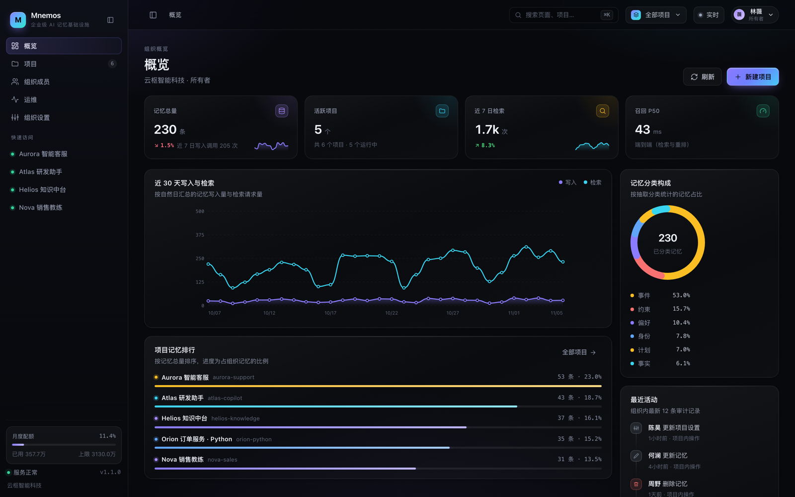
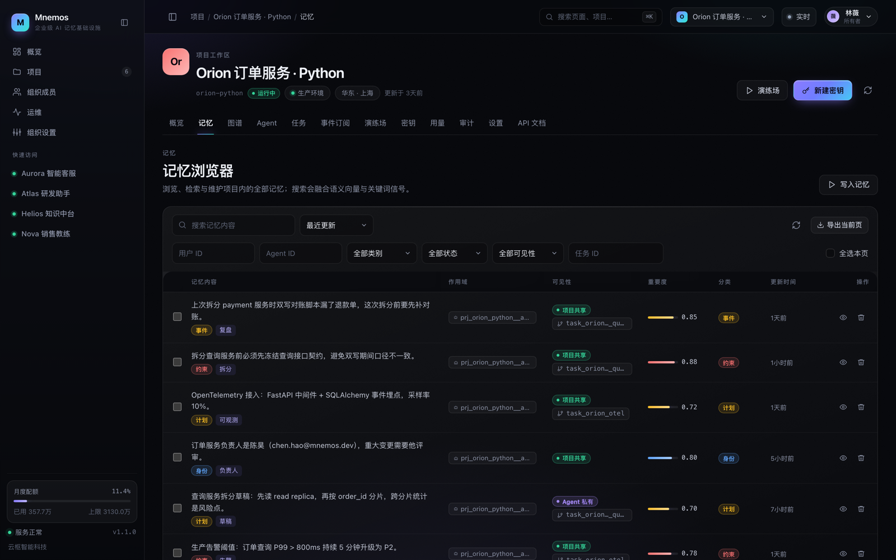
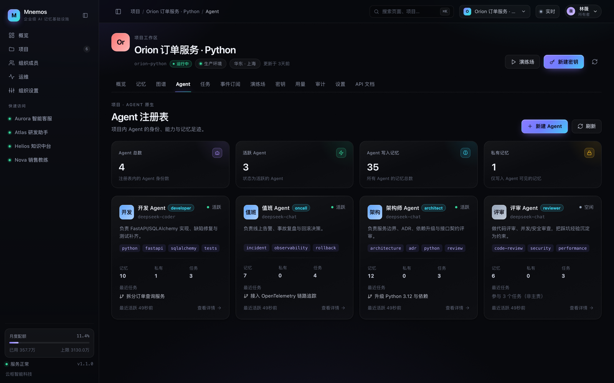
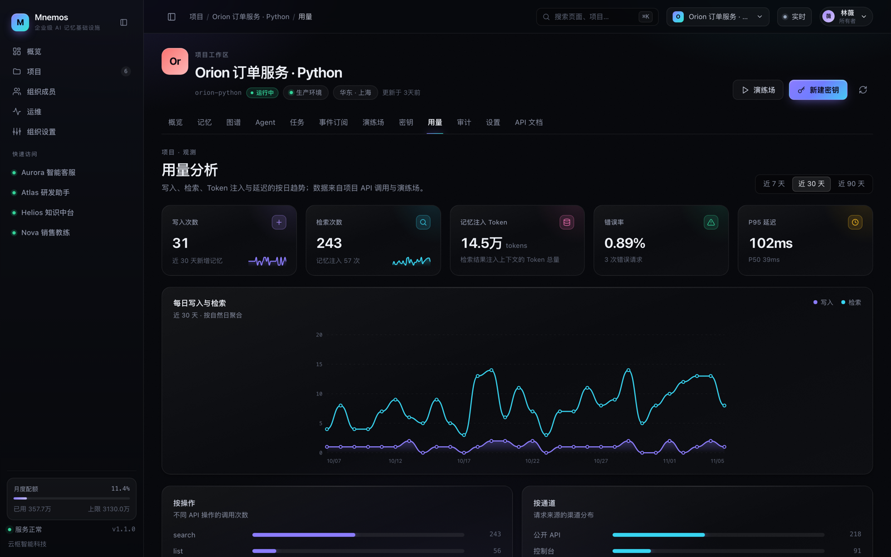
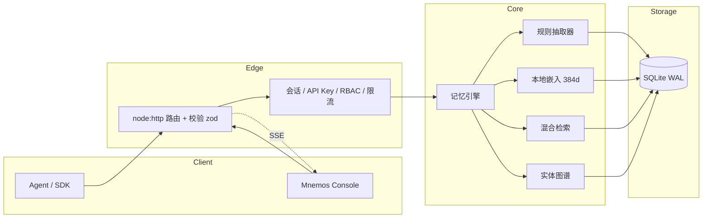

# Mnemos · 企业级多项目 AI 记忆基础设施

> 面向 **多 Agent × 多项目** 的记忆基础设施。它的用户是 Agent，不是人：不同 Agent、或同一 Agent 在不同时间段，在同一个项目上工作时共享同一份可追溯的经验。
> 控制台只是人类观测、审计和调参的窗口。纯 Node 26 + SQLite + 原生 TypeScript，**零外部服务、零运行时依赖**（仅 zod 做校验），开箱即用。

**Agent 原生能力**：Agent 注册表 · 任务会话（跨时间段归因）· 项目/Agent/任务三档可见性 · 任务简报（把项目经验压成可注入的 system prompt）· 任务结束自动沉淀决策与教训。详见 [`docs/agent-memory-model.md`](docs/agent-memory-model.md)。

```
组织（Org）
 └── 项目（Project）── 独立向量空间 / 词项索引 / 实体图 / 密钥 / 配额 / 审计
      └── 记忆作用域：user_id × agent_id × run_id × app_id
```

---

## 为什么需要「多项目」记忆基础设施

mem0 把记忆抽象为 `user_id / agent_id / run_id` 三个维度；真实企业里，一个记忆服务往往同时服务客服、研发、销售、知识中台等多个业务线。它们需要：

| 企业诉求 | Mnemos 的做法 |
| --- | --- |
| 业务线数据互不可见 | 项目级硬隔离，所有查询强制带 `project_id` |
| 每业务独立配额与保留策略 | 项目级 `settings`（topK/阈值/权重/保留期/月配额/图谱开关） |
| 密钥按业务发放与吊销 | API Key 属于项目，带作用域与限流，可随时吊销 |
| 谁能看谁的记忆 | 组织角色 + 项目成员角色（owner/admin/developer/viewer） |
| 出问题能追溯 | 每次写入/更新/删除/搜索都有审计日志与用量事件 |
| 检索结果要能解释 | 每条命中返回 5 个信号分量与融合权重 |

---

## 典型场景：一个 Python 服务，多个 Agent 接力

```
架构师 Agent ── 搭建骨架、ADR、依赖升级 ──┐
开发 Agent   ── 缺陷修复、功能实现 ────────┤  同一个项目，共享记忆
评审 Agent   ── 并发/安全约束、踩坑复盘 ───┤  任务 = 时间轴上的工作单元
值班 Agent   ── 事故记录、告警阈值 ────────┘  可见性 = project / agent / task
```

演示项目 **Orion 订单服务**（`orion-python`）包含 4 个 Agent、6 个任务：库存超卖事故的根因与修复、支付回调幂等约束、Python 3.12 升级结论，都会出现在下一个 Agent 的任务简报里 —— 即使换了 Agent、隔了几周。

```bash
# Agent 开始任务前拉取上下文简报
curl -X POST $BASE/v1/context \
  -H "Authorization: Bearer $KEY" -H 'content-type: application/json' \
  -d '{"agent_id":"agent-coder","task_id":"task_orion_split_query","budget_tokens":1200}'
```

返回按 section 分层的记忆、可直接注入提示词的 `prompt`、来源 `citations` 与 token 估算。

---

## 核心能力

- **Agent 原生**：Agent 注册表、任务会话、三档可见性、任务简报、结束任务自动沉淀决策/教训。
- **记忆写入**：`infer=true` 时规则抽取事实（离线可跑），`infer=false` 原文入库；`additive` 只增不改、`consolidate` 高相似去重合并。
- **多信号混合检索**：语义向量 + BM25 关键词 + 实体命中 + 时效性 + 重要度加权融合，返回逐信号分解。
- **本地确定性嵌入**：CJK 感知的 char n-gram + 词特征哈希到 384 维，L2 归一化；同一文本永远得到同一向量，无需 API Key。
- **知识图谱**：事实抽取实体（人物/组织/产品/技术/时间/地点）与关系，实体共现建边，控制台可视化。
- **版本与历史**：每次变更写入 `memory_history`，记录 old/new、actor、reason。
- **企业治理**：API Key 作用域、RBAC、限流、审计日志、用量分析（p50/p95/p99、错误率、Token）。
- **实时控制台**：SSE 事件流（`/api/events`）、命令面板、记忆浏览器、图谱、检索演练场。
- **演示数据**：6 个项目、230 条中文策展记忆、15 个 Agent、6 个任务、8500+ 条用量事件与审计日志，首次启动自动 seed。

---

## 快速开始

```bash
cd mnemos
pnpm install          # 仅需一次（zod / react / vite 等）
pnpm seed             # 可选：重建演示数据集（--force 会清空）
pnpm build            # 构建控制台静态资源
pnpm start            # 启动服务：http://127.0.0.1:4380
```

打开 <http://127.0.0.1:4380>，使用演示账号登录：

| 邮箱 | 姓名 | 角色 | 密码 |
| --- | --- | --- | --- |
| `lin.wei@mnemos.dev` | 林薇 | 所有者 | `mnemos-demo` |
| `chen.hao@mnemos.dev` | 陈昊 | 管理员 | `mnemos-demo` |
| `su.yan@mnemos.dev` | 苏妍 | 只读 | `mnemos-demo` |

开发模式（前端热更新）：

```bash
pnpm dev       # 后端 4380，自动 seed
pnpm dev:web   # 控制台 4381，代理 /api 与 /v1 到 4380
```

验证：

```bash
pnpm typecheck
pnpm test
pnpm verify    # typecheck + test + build
```

---

## 记忆流水线

```
messages / text
   │
   ├─ infer=true ──► 规则抽取器（分句/代词归一/分类/重要度/实体/关系）
   │                    └─ 可选：配置 LLM 后替换为模型抽取（同一接口）
   ├─ infer=false ─► 原文单条入库
   │
   ▼
去重与合并（consolidate 模式：余弦 ≥ dedupeThreshold → NOOP/MERGE）
   │
   ├─► 确定性嵌入 384 维（char n-gram + 词特征哈希）
   ├─► 中文友好分词 → memory_terms（BM25 倒排）
   ├─► 实体 & 关系 → entities / memory_entities / relations
   └─► memory_history（ADD/UPDATE/DELETE/MERGE/NOOP）
```

检索时并行计算 5 个信号，按项目权重融合：

```
score = w_semantic·cos + w_keyword·BM25' + w_entity·overlap
      + w_recency·exp(-days/30) + 0.15·importance
```

实体未命中时，实体权重按比例回退到语义与关键词，避免"权重空转"。

---

## 控制台

| 页面 | 说明 |
| --- | --- |
| 概览 | 组织级 KPI、30 天趋势、分类构成、项目排行、审计与实时事件流 |
| 项目 | 卡片/表格双视图、新建项目、配额与成员概览 |
| 项目 · 概览 | 项目 KPI、健康检查、高频实体、最近记忆、接入示例 |
| 项目 · 记忆 | 混合检索、可见性/任务筛选、批量操作、详情抽屉（历史/实体/信号分解/反馈） |
| 项目 · Agent | Agent 注册表：角色、模型、能力、记忆足迹、最近任务、生成简报 |
| 项目 · 任务 | 任务会话时间线、任务内记忆、结束任务沉淀决策/教训、简报预览 |
| 项目 · 图谱 | 实体关系图谱，类型过滤、节点详情、边权重 |
| 项目 · 演练场 | 写入与检索双向调试，展示事件流与信号分解 |
| 项目 · 密钥 | 创建（一次性展示）、作用域、吊销 |
| 项目 · 用量 | 7/30/90 天趋势、按操作/通道/密钥分布、p50/p95/p99 |
| 项目 · 审计 | 筛选、详情、导出 |
| 项目 · 设置 | 抽取模式、去重阈值、检索权重、配额、项目信息、危险区 |
| 项目 · API 文档 | curl / TypeScript / Python 示例与错误码 |

设计语言：深空黑底 + 极光渐变 + 1px 发丝描边 + 玻璃浮层，纯手写 CSS 设计令牌（`web/src/styles`），无 UI 库。

### 界面预览

| 组织概览 | 项目记忆浏览器 |
| --- | --- |
|  |  |

| Agent 注册表 | 任务会话（跨 Agent 接力） |
| --- | --- |
|  |  |

| 混合检索（可解释分数） | 知识图谱 |
| --- | --- |
|  |  |

| 检索演练场 | 用量分析 |
| --- | --- |
|  |  |

| 项目设置 | API 文档 |
| --- | --- |
|  |  |

| 系统运维（配额/保留期/备份/维护） | 组织成员与登录安全 |
| --- | --- |
|  |  |

| 事件订阅（Webhook） |
| --- |
|  |

> 截图由 `node scripts/capture.mjs` 自动生成（headless Chrome + CDP，登录态注入）。

---

## 公开 API（`/v1`，snake_case）

```bash
KEY=mnemos_live_demo_aurora_console   # seed 生成的演示密钥
BASE=http://127.0.0.1:4380

# 写入记忆
curl -X POST $BASE/v1/memories \
  -H "Authorization: Bearer $KEY" -H 'content-type: application/json' \
  -d '{"messages":[{"role":"user","content":"我偏好每周一上午收到周报，格式 CSV"}],
       "user_id":"cust-1042","agent_id":"agent-support-l1"}'

# 混合检索
curl -X POST $BASE/v1/memories/search \
  -H "Authorization: Bearer $KEY" -H 'content-type: application/json' \
  -d '{"query":"周报格式偏好","user_id":"cust-1042","top_k":5}'

# 列表 / 详情 / 历史 / 图谱 / 统计
curl "$BASE/v1/memories?user_id=cust-1042&page=1" -H "Authorization: Bearer $KEY"
curl "$BASE/v1/memories/{id}" -H "Authorization: Bearer $KEY"
curl "$BASE/v1/memories/{id}/history" -H "Authorization: Bearer $KEY"
curl "$BASE/v1/graph?limit=80" -H "Authorization: Bearer $KEY"
curl "$BASE/v1/stats" -H "Authorization: Bearer $KEY"
```

完整接口、响应示例与错误码见控制台「项目 · API 文档」，以及 [`docs/api.md`](docs/api.md)。

---

## 架构



- **传输层** `server/src/http`：路由、鉴权、校验、审计、用量、SSE、静态资源（SPA 回退）。
- **引擎层** `server/src/engine`：分词 / 嵌入 / 抽取 / 检索 / 图谱 / 记忆服务。
- **存储层** `server/src/db`：schema、迁移、事务；`node:sqlite` 同步 API。
- **控制台** `web/src`：设计系统、UI 组件、图表、页面。

详见 [`docs/architecture.md`](docs/architecture.md)。

---

## 目录结构

```
mnemos/
├── shared/src/           # 领域类型与常量（前后端唯一契约）
├── server/src/
│   ├── db/               # schema.sql / 连接 / 迁移
│   ├── engine/           # 分词、嵌入、抽取、检索、图谱、记忆服务
│   ├── http/             # 路由、鉴权、校验、审计、用量、SSE、静态托管
│   ├── lib/              # ID、密码、事件总线、审计、用量
│   ├── seed/             # 演示数据（确定性）
│   └── main.ts           # 启动入口
├── web/src/
│   ├── styles/           # 设计令牌 + 基础样式 + 组件样式
│   ├── components/       # ui / charts / shell / project
│   ├── pages/            # 控制台页面
│   └── lib/              # api、auth、hooks、format、tone
├── docs/                 # 架构、API、设计系统、运维
└── data/mnemos.db        # 运行时数据库（gitignore）
```

---

## 配置

| 环境变量 | 默认值 | 说明 |
| --- | --- | --- |
| `MNEMOS_PORT` | `4380` | 服务端口 |
| `MNEMOS_HOST` | `127.0.0.1` | 监听地址 |
| `MNEMOS_DATA_DIR` | `./data` | 数据目录 |
| `MNEMOS_DB_PATH` | `./data/mnemos.db` | SQLite 路径 |
| `MNEMOS_DEMO` | `1` | 空库时自动写入演示数据 |
| `MNEMOS_AUTH_DISABLED` | `0` | 仅本地调试使用 |
| `MNEMOS_SESSION_TTL_HOURS` | `72` | 控制台会话有效期 |
| `MNEMOS_LLM_BASE_URL` + `MNEMOS_LLM_API_KEY` | 空 | 配置后启用模型抽取/嵌入（可选） |

---

## 集成面：事件订阅与 SDK

项目级 Webhook：记忆与任务事件以 **HMAC-SHA256 签名**推送到业务系统，失败指数退避重试，死信可重放。

```bash
# 创建订阅（secret 只返回一次）
curl -X POST localhost:4380/api/projects/prj_orion_python/webhooks \
  -H "authorization: Bearer $TOKEN" -H 'content-type: application/json' \
  -d '{"name":"事件总线","url":"https://events.example.com/hooks/mnemos",
       "eventTypes":["memory.created","memory.updated","task.finished"]}'

# 收到请求时校验（Node）
# x-mnemos-signature: t=1712345678,v1=<hex>
# v1 = HMAC_SHA256(secret, `${t}.${rawBody}`)
```

- 事件：`memory.created/updated/deleted`、`task.finished`、`agent.registered`、`key.created/revoked`、`quota.exceeded`
- 重试：5s → 30s → 2m → 10m → 1h → 6h，达到上限转死信；连续失败 10 次自动暂停
- 安全：仅 http/https、DNS 解析后拒绝私网/回环/云元数据，防 SSRF
- 控制台「项目 · 事件订阅」可查看每次投递的响应码、延迟、错误并手动重放

官方 SDK（零第三方依赖）：

```ts
import { MnemosClient } from '@mnemos/sdk';

const client = new MnemosClient({ apiKey: process.env.MNEMOS_API_KEY!, baseUrl: 'http://127.0.0.1:4380' });
const task = await client.tasks.create({ title: '拆分订单查询服务', branch: 'feat/query-service' });
const brief = await client.context.build({ agentId: 'agent-coder', taskId: task.id, budgetTokens: 1200 });
console.log(brief.prompt);
await client.memories.add({ text: '查询走 read replica，按 order_id 分片', visibility: 'project', taskId: task.id });
```

```python
from mnemos_sdk import MnemosClient

client = MnemosClient(api_key="mnemos_live_...", base_url="http://127.0.0.1:4380")
hits = client.memories.search(query="幂等键 约束", agent_id="agent-coder", top_k=5)
for hit in hits.results:
    print(hit.score, hit.memory)
```

见 [`sdk/README.md`](sdk/README.md)、[`sdk/typescript`](sdk/typescript)、[`sdk/python`](sdk/python)。

## 可观测性

- `/metrics`（Prometheus）：请求量/延迟直方图/错误/限流/登录失败/SSE/Webhook 队列
- OpenTelemetry：设置 `MNEMOS_OTEL_ENABLED=1` 与 `MNEMOS_OTEL_ENDPOINT` 后，每个请求生成 server span（`x-trace-id` 返回并写入访问日志）
- Grafana 面板：`deploy/grafana/dashboards/mnemos-overview.json`
- 告警规则：`deploy/prometheus/alerts.yml`（服务不可用、5xx、p95、限流/登录失败突增、Webhook 失败/积压）
- 本地观测栈：`deploy/observability/docker-compose.yml`（Prometheus + Grafana + OTel Collector）

详见 [`docs/observability.md`](docs/observability.md)。存储与多副本演进见 [`docs/scaling.md`](docs/scaling.md)。

## DSH 插件（dsh-mnemos）

把 Mnemos 接入 [DeepSeek Harness](https://github.com/deepseek-ai/deepseek-harness)，让 DSH 里的 Agent 直接拥有
「项目级共享记忆 + 任务会话」：

- 10 个工具：`mnemos_search` / `mnemos_add` / `mnemos_context`（任务简报）/ `mnemos_task` /
  `mnemos_get` / `mnemos_update` / `mnemos_delete` / `mnemos_history` / `mnemos_agent` / `mnemos_status`
- 设置页自动表单（`Config` + `.volatile()`），`readOnly` 安全开关，系统提示注入使用时机
- host-only、零 harness 运行时依赖，通过 `dsh plugin add link:` 热插拔

```bash
cd integrations/dsh-mnemos
pnpm install --ignore-workspace && pnpm build

dsh plugin --profile desktop add link:/Volumes/wd2025/devel/aiworker/mnemos/integrations/dsh-mnemos
# 重启 DSH → 设置 → 插件 → dsh-mnemos → 配置
#   baseUrl = http://127.0.0.1:4380
#   apiKey  = 控制台「项目 → 密钥」创建（memories:read/write；/v1/stats 需 admin）
#   defaultAgentId = 项目里已注册的 Agent id（如 prj_orion_python__agent-coder）
```

详见 [`integrations/dsh-mnemos/README.md`](integrations/dsh-mnemos/README.md)（安装、配置、示例对话、排障、与 dsh-mem0 的差异）。

## 生产部署与运维

单节点生产部署的完整说明：

| 文档 | 内容 |
| --- | --- |
| [`docs/production-readiness.md`](docs/production-readiness.md) | 成熟度矩阵（P0/P1/P2）、SLO、容量估算、发布/回滚、故障演练、数据保留与备份策略 |
| [`docs/security.md`](docs/security.md) | 威胁模型、控制项、密钥生命周期、事件响应清单、安全基线 |
| [`docs/operations.md`](docs/operations.md) | 启动/预检、探针与 `/metrics`、维护任务、备份恢复、迁移升级、密钥轮换、登录锁定、日志字段、常见告警 |
| [`docs/api.md`](docs/api.md) | `/v1` 与 `/api` 接口；在线版：`GET /openapi.json` |
| [`docs/scaling.md`](docs/scaling.md) | 存储与规模演进：Postgres/pgvector、读写分离、多副本（P1 计划，未实现） |

生产运行端点：`/healthz`（存活）、`/readyz`（就绪）、`/metrics`（Prometheus）、`/openapi.json`（OpenAPI 3.1）。`/metrics` 与探针应只在内网暴露。

常用命令（均在仓库根目录执行）：

```bash
# 1) 环境预检（Node ≥22.18 / 目录可写 / 端口 / DB 完整性 / 磁盘 ≥1GB）
mkdir -p data/backups
bash scripts/preflight.sh

# 2) 压测（只读流量：搜索/列表/概览；p95 或错误率超阈值退出码 1）
node scripts/load-test.mjs --base http://127.0.0.1:4380 \
  --concurrency 16 --duration 10 --max-p95-ms 500 --max-error-rate 1%

# 3) 安全基线（黑盒；未上线接口标记 SKIP，FAIL 退出码 1）
node scripts/security-check.mjs --auto-start --base http://127.0.0.1:4392

# 4) 备份 / 恢复演练（API 备份 → 完整性/计数 → migrate → 4398 临时实例恢复）
bash scripts/backup-restore-drill.sh
```

生产要点：`MNEMOS_DEMO=0`；空库首次启动必须设置 `MNEMOS_BOOTSTRAP_EMAIL` / `MNEMOS_BOOTSTRAP_PASSWORD`（否则拒绝启动）；反向代理终止 TLS；吊销 `mnemos_live_demo_*` 演示密钥；数据/备份目录 700；备份异地加密；每月恢复演练。详见上述文档。

容器部署（Dockerfile / docker-compose.yml）：

```bash
docker compose up -d --build
docker compose logs -f mnemos
```

> 说明：开发环境**没有 Docker**，镜像构建与容器运行**未在本机验证**；CI 中 docker job 仅执行 `docker build` 做语法/依赖验证。真实部署前请在具备 Docker 的环境完成“构建 → 健康检查 → 备份恢复”验证。

---

## 与 mem0 的对照

| mem0 | Mnemos |
| --- | --- |
| 单用户/单 Agent 记忆 API | 增加组织 → 项目两级多租户与 RBAC |
| 向量库 + 可选图存储 | 单机 SQLite：向量 + BM25 倒排 + 实体图，事务一致 |
| 依赖 OpenAI 做抽取/嵌入 | 内置确定性离线实现，可选接入模型 |
| 托管控制台（Cloud） | 自带控制台：记忆浏览器、图谱、演练场、密钥、用量、审计、设置 |
| `add/search/get/update/delete/history` | 兼容同构 API，并返回逐信号可解释分数 |

---

## 安全与合规

- 密码 PBKDF2-SHA256（120k 迭代），会话令牌仅存哈希；API Key 只存 SHA-256，创建时明文展示一次。
- 所有 SQL 参数化；请求体上限 1MB；API Key 维度限流。
- 审计日志记录 actor（用户/密钥/系统）、动作、资源、IP、UA。
- 保留期与配额按项目配置，过期记忆可批量归档/清除。
- 演示环境请勿用于生产：默认 cookie-less Bearer 会话 + 演示密钥。

---

## 路线图

1. 抽取器接入 LLM（同一 `Extractor` 接口）与 embedding 供应商。
2. 向量规模超过 10 万条时切换 SQLite 扩展（sqlite-vss）或外部向量库。
3. 记忆质量评分、漂移告警、自动摘要与遗忘曲线。
4. 组织级 SSO（OIDC/SAML）与 SCIM 成员同步。
5. 多副本部署：写主 + 只读副本、审计日志外送。
