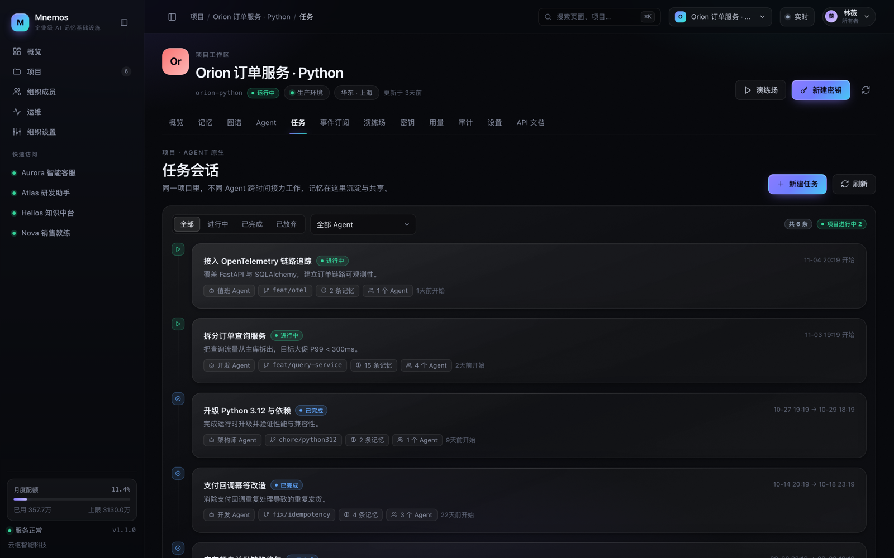
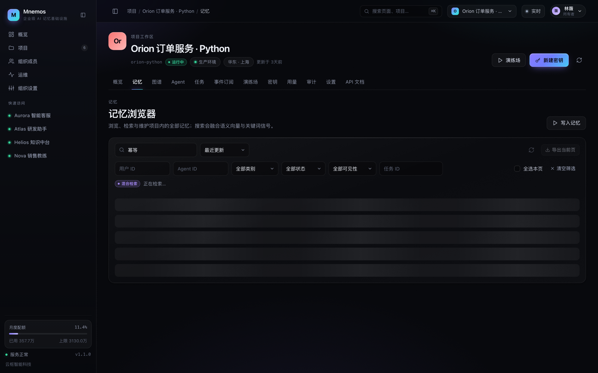
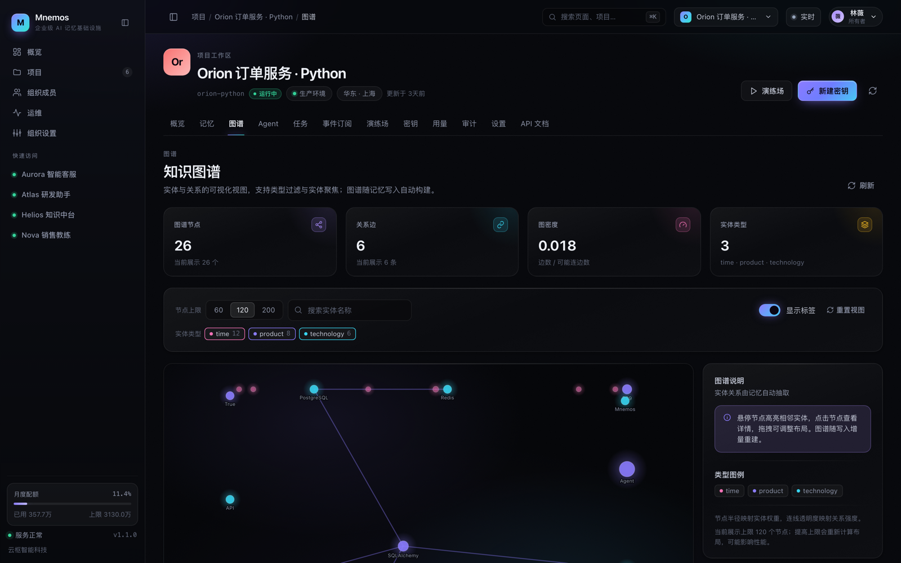
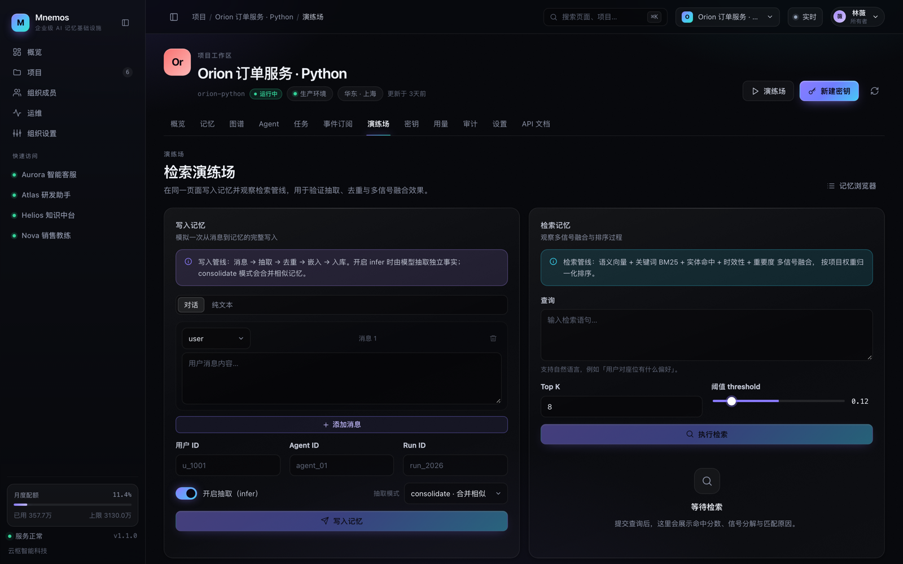
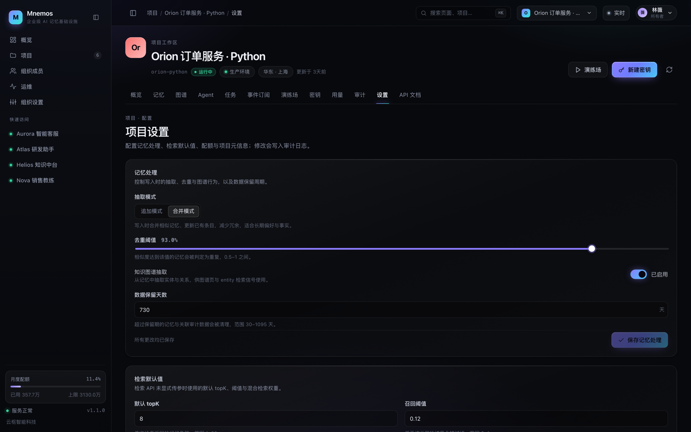
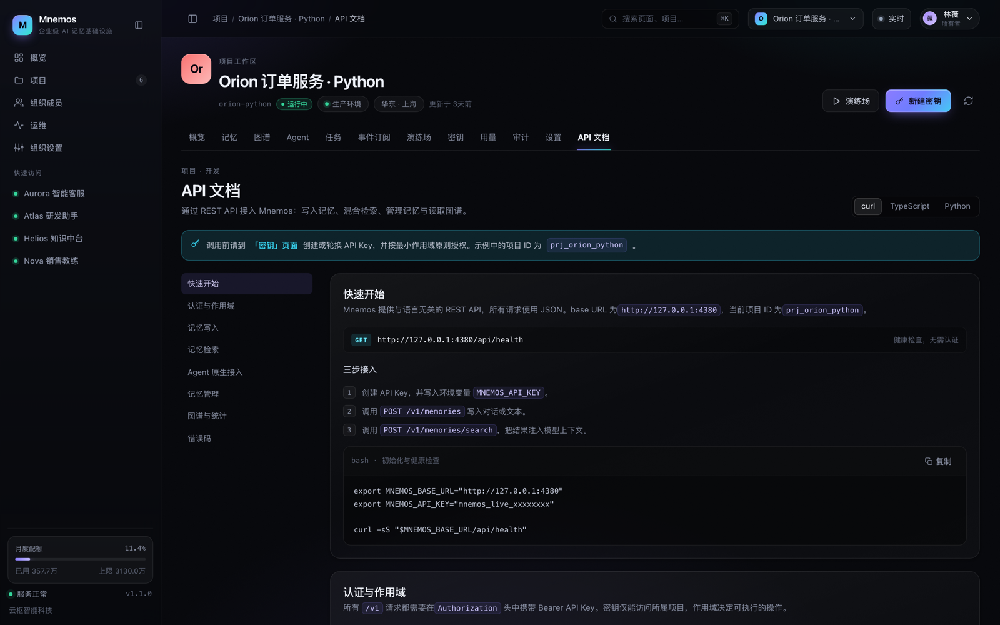
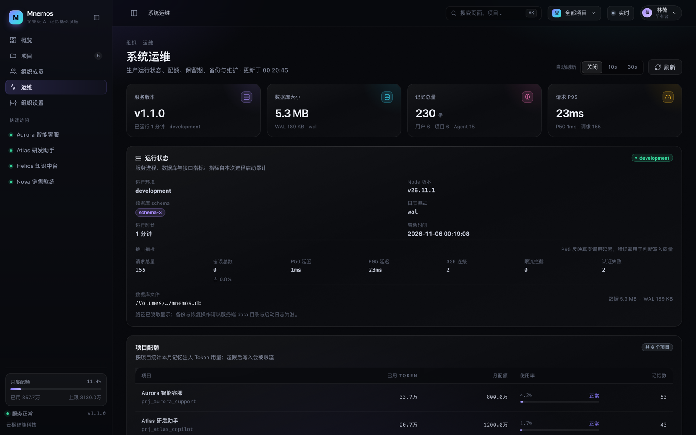
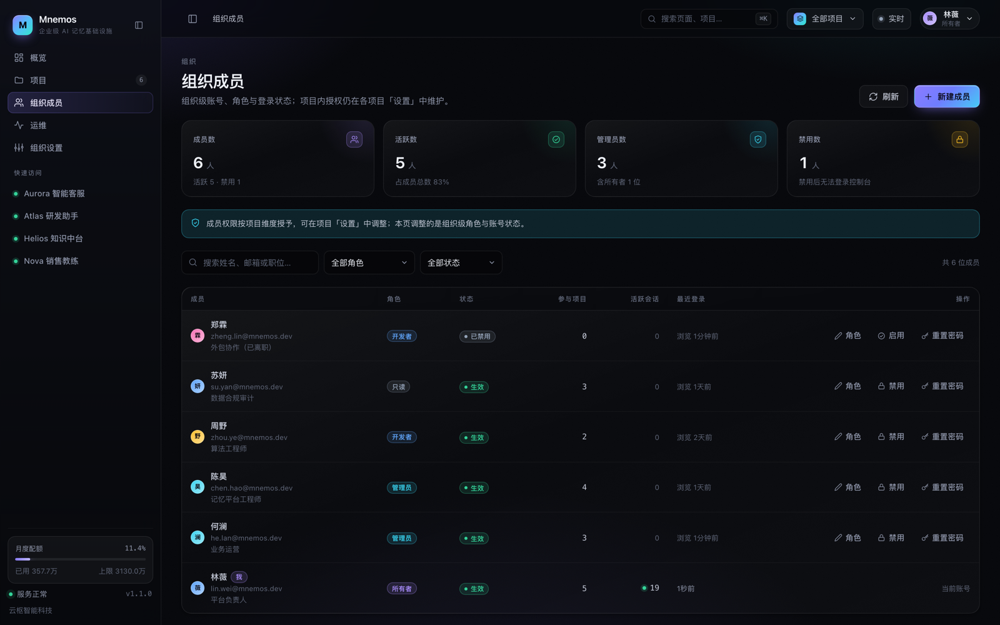
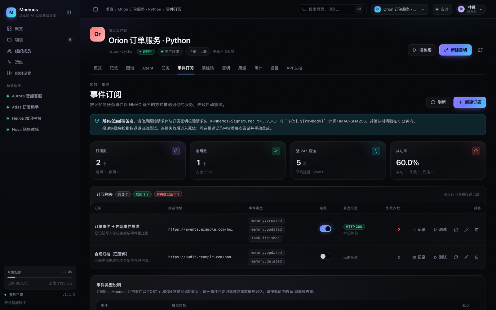
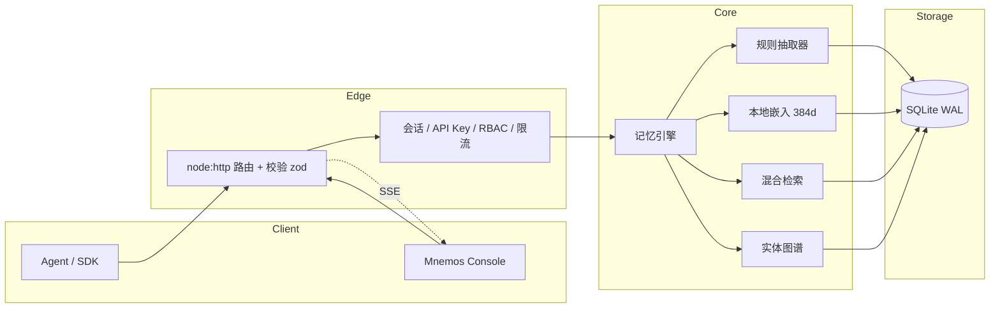

# Mnemos · 企业级多项目 AI 记忆基础设施

> 面向 **多 Agent × 多项目** 的记忆基础设施。它的用户是 Agent，也是人：不同 Agent、或同一 Agent 在不同时间段，在同一个项目上工作时共享同一份可追溯的经验；App 的真人用户、客服、研发智能体也能以「人」为单位拥有各自的长期记忆。
> 控制台只是人类观测、审计和调参的窗口。纯 Node 26 + SQLite + 原生 TypeScript，**零外部服务、零运行时依赖**（仅 zod 做校验），开箱即用。

**v5 中立记忆服务**：记忆以 **人（Person）** 组织、以 **分区（Partition）** 隔离——服务只认「分区 + 人」两个键，不预设业务形态（App 用户、研发智能体、客服、租户都能用）。详见 [`docs/neutral-memory-model.md`](docs/neutral-memory-model.md) 与 [「中立记忆服务：分区 + 人」](#中立记忆服务分区--人v5)。

**Agent 原生能力（兼容层）**：Agent 注册表 · 任务会话（跨时间段归因）· 项目/Agent/任务三档可见性 · 任务简报（把项目经验压成可注入的 system prompt）· 任务结束自动沉淀决策与教训。详见 [`docs/agent-memory-model.md`](docs/agent-memory-model.md)。

```
组织（Org）
 └── 分区（Partition）—— 独立向量空间 / 词项索引 / 实体图 / 密钥 / 配额 / 审计
      ├── 人（Person）—— human / agent / service，记忆按人归属
      └── 记忆 scope：person（仅该人） / partition（分区共享） / session（仅本会话）
```

---

## 为什么需要「多项目」记忆基础设施

mem0 把记忆抽象为 `user_id / agent_id / run_id` 三个维度；真实企业里，一个记忆服务往往同时服务客服、研发、销售、知识中台等多个业务线。它们需要：

| 企业诉求 | Mnemos 的做法 |
| --- | --- |
| 业务线数据互不可见 | 项目级硬隔离，所有查询强制带 `project_id` |
| 每业务独立配额与保留策略 | 项目级 `settings`（topK/阈值/权重/保留期/月配额/图谱开关） |
| 密钥按业务发放与吊销 | API Key 属于项目，带作用域与限流，可随时吊销 |
| 谁能看谁的记忆 | 组织角色 + 项目成员角色（owner/admin/developer/viewer） |
| 出问题能追溯 | 每次写入/更新/删除/搜索都有审计日志与用量事件 |
| 检索结果要能解释 | 每条命中返回 5 个信号分量与融合权重 |

---

## 典型场景：一个 Python 服务，多个 Agent 接力

```
架构师 Agent ── 搭建骨架、ADR、依赖升级 ──┐
开发 Agent   ── 缺陷修复、功能实现 ────────┤  同一个项目，共享记忆
评审 Agent   ── 并发/安全约束、踩坑复盘 ───┤  任务 = 时间轴上的工作单元
值班 Agent   ── 事故记录、告警阈值 ────────┘  可见性 = project / agent / task
```

演示项目 **Orion 订单服务**（`orion-python`）包含 4 个 Agent、6 个任务：库存超卖事故的根因与修复、支付回调幂等约束、Python 3.12 升级结论，都会出现在下一个 Agent 的任务简报里 —— 即使换了 Agent、隔了几周。

```bash
# Agent 开始任务前拉取上下文简报
curl -X POST $BASE/v1/context \
  -H "Authorization: Bearer $KEY" -H 'content-type: application/json' \
  -d '{"agent_id":"agent-coder","task_id":"task_orion_split_query","budget_tokens":1200}'
```

返回按 section 分层的记忆、可直接注入提示词的 `prompt`、来源 `citations` 与 token 估算。

---

## 核心能力

- **中立记忆服务（v5）**：分区隔离 + 人（human/agent/service）归属，人级简报/上下文/做梦；org key 可跨分区建分区。
- **Agent 原生（兼容层）**：Agent 注册表、任务会话、三档可见性、任务简报、结束任务自动沉淀决策/教训。
- **记忆写入**：`infer=true` 时规则抽取事实（离线可跑），`infer=false` 原文入库；`additive` 只增不改、`consolidate` 高相似去重合并。
- **多信号混合检索**：语义向量 + BM25 关键词 + 实体命中 + 时效性 + 重要度加权融合，返回逐信号分解。
- **本地确定性嵌入**：CJK 感知的 char n-gram + 词特征哈希到 384 维，L2 归一化；同一文本永远得到同一向量，无需 API Key。
- **记忆简报与做梦**：把最近活跃记忆压成有字符上限、可直接注入提示词的简报；增量做梦把尚未整理的新记忆归纳为 `insight` 洞见（不重放旧记忆、不删原记忆，LLM 可选）。
- **知识图谱**：事实抽取实体（人物/组织/产品/技术/时间/地点）与关系，实体共现建边，控制台可视化。
- **版本与历史**：每次变更写入 `memory_history`，记录 old/new、actor、reason。
- **企业治理**：API Key 作用域、RBAC、限流、审计日志、用量分析（p50/p95/p99、错误率、Token）。
- **实时控制台**：SSE 事件流（`/api/events`）、命令面板、记忆浏览器、图谱、检索演练场。
- **演示数据**：6 个分区、256 条中文策展记忆（含 4 条做梦洞见）、15 个 Agent、21 个记忆主体（human / agent）、6 个任务、8400+ 条用量事件与审计日志，首次启动自动 seed。

---

## 快速开始

```bash
cd mnemos
pnpm install          # 仅需一次（zod / react / vite 等）
pnpm seed             # 可选：重建演示数据集（--force 会清空）
pnpm build            # 构建控制台静态资源
pnpm start            # 启动服务：http://127.0.0.1:4380
```

打开 <http://127.0.0.1:4380>，使用演示账号登录：

| 邮箱 | 姓名 | 角色 | 密码 |
| --- | --- | --- | --- |
| `lin.wei@mnemos.dev` | 林薇 | 所有者 | `mnemos-demo` |
| `chen.hao@mnemos.dev` | 陈昊 | 管理员 | `mnemos-demo` |
| `su.yan@mnemos.dev` | 苏妍 | 只读 | `mnemos-demo` |

开发模式（前端热更新）：

```bash
pnpm dev       # 后端 4380，自动 seed
pnpm dev:web   # 控制台 4381，代理 /api 与 /v1 到 4380
```

验证：

```bash
pnpm typecheck
pnpm test
pnpm verify    # typecheck + test + build
```

---

## 记忆流水线

```
messages / text
   │
   ├─ infer=true ──► 规则抽取器（分句/代词归一/分类/重要度/实体/关系）
   │                    └─ 可选：配置 LLM 后替换为模型抽取（同一接口）
   ├─ infer=false ─► 原文单条入库
   │
   ▼
去重与合并（consolidate 模式：余弦 ≥ dedupeThreshold → NOOP/MERGE）
   │
   ├─► 确定性嵌入 384 维（char n-gram + 词特征哈希）
   ├─► 中文友好分词 → memory_terms（BM25 倒排）
   ├─► 实体 & 关系 → entities / memory_entities / relations
   └─► memory_history（ADD/UPDATE/DELETE/MERGE/NOOP）
```

检索时并行计算 5 个信号，按项目权重融合：

```
score = w_semantic·cos + w_keyword·BM25' + w_entity·overlap
      + w_recency·exp(-days/30) + 0.15·importance
```

实体未命中时，实体权重按比例回退到语义与关键词，避免"权重空转"。

---

## 控制台

| 页面 | 说明 |
| --- | --- |
| 概览 | 组织级 KPI、30 天趋势、分类构成、项目排行、审计与实时事件流 |
| 项目 | 卡片/表格双视图、新建项目、配额与成员概览 |
| 项目 · 概览 | 项目 KPI、健康检查、高频实体、最近记忆、接入示例 |
| 分区 · 人 | 人列表（真人/智能体筛选、搜索、状态、记忆统计）→ 人详情（资料、记忆时间线、简报、会话、洞察、做梦） |
| 项目 · 记忆 | 混合检索、可见性/任务筛选、批量操作、详情抽屉（历史/实体/信号分解/反馈） |
| 项目 · Agent | Agent 注册表：角色、模型、能力、记忆足迹、最近任务、生成简报 |
| 项目 · 任务 | 任务会话时间线、任务内记忆、结束任务沉淀决策/教训、简报预览 |
| 项目 · 图谱 | 实体关系图谱，类型过滤、节点详情、边权重 |
| 项目 · 演练场 | 写入与检索双向调试，展示事件流与信号分解 |
| 项目 · 密钥 | 创建（一次性展示）、作用域、吊销 |
| 项目 · 用量 | 7/30/90 天趋势、按操作/通道/密钥分布、p50/p95/p99 |
| 项目 · 审计 | 筛选、详情、导出 |
| 项目 · 设置 | 抽取模式、去重阈值、检索权重、配额、项目信息、危险区 |
| 项目 · API 文档 | curl / TypeScript / Python 示例与错误码 |

设计语言：深空黑底 + 极光渐变 + 1px 发丝描边 + 玻璃浮层，纯手写 CSS 设计令牌（`web/src/styles`），无 UI 库。

### 界面预览

| 组织概览 | 项目记忆浏览器 |
| --- | --- |
|  |  |

| Agent 注册表 | 任务会话（跨 Agent 接力） |
| --- | --- |
|  |  |

| 混合检索（可解释分数） | 知识图谱 |
| --- | --- |
|  |  |

| 检索演练场 | 用量分析 |
| --- | --- |
|  |  |

| 项目设置 | API 文档 |
| --- | --- |
|  |  |

| 系统运维（配额/保留期/备份/维护） | 组织成员与登录安全 |
| --- | --- |
|  |  |

| 事件订阅（Webhook） |
| --- |
|  |

> 截图由 `node scripts/capture.mjs` 自动生成（headless Chrome + CDP，登录态注入）。

---

## 公开 API（`/v1`，snake_case）

```bash
KEY=mnemos_live_demo_aurora_console   # seed 生成的演示密钥
BASE=http://127.0.0.1:4380

# 写入记忆
curl -X POST $BASE/v1/memories \
  -H "Authorization: Bearer $KEY" -H 'content-type: application/json' \
  -d '{"messages":[{"role":"user","content":"我偏好每周一上午收到周报，格式 CSV"}],
       "user_id":"cust-1042","agent_id":"agent-support-l1"}'

# 混合检索
curl -X POST $BASE/v1/memories/search \
  -H "Authorization: Bearer $KEY" -H 'content-type: application/json' \
  -d '{"query":"周报格式偏好","user_id":"cust-1042","top_k":5}'

# 列表 / 详情 / 历史 / 图谱 / 统计
curl "$BASE/v1/memories?user_id=cust-1042&page=1" -H "Authorization: Bearer $KEY"
curl "$BASE/v1/memories/{id}" -H "Authorization: Bearer $KEY"
curl "$BASE/v1/memories/{id}/history" -H "Authorization: Bearer $KEY"
curl "$BASE/v1/graph?limit=80" -H "Authorization: Bearer $KEY"
curl "$BASE/v1/stats" -H "Authorization: Bearer $KEY"
```

完整接口、响应示例与错误码见控制台「项目 · API 文档」，以及 [`docs/api.md`](docs/api.md)。

---

## 中立记忆服务：分区 + 人（v5）

v4 的记忆模型是「项目 × Agent × 任务」。真实业务里，同一个记忆服务往往还要服务 **App 的真人用户**：
他们不是 Agent，也不需要登录控制台，只需要「我的偏好/我的记录只有我能看到」。v5 因此把模型收敛为两个键：

| 概念 | 含义 | 存储 |
| --- | --- | --- |
| **分区 Partition** | 隔离边界：项目 / 应用 / 租户 / 工作区；分区之间硬隔离 | `projects`（对外叫 partition，`project_id` 列名保留） |
| **人 Person** | 记忆主体：`human`（App 用户、员工）/ `agent`（智能体）/ `service` | `persons`（`(partition, type, external_id)` 唯一） |
| **scope** | `person` 仅该人可见 / `partition` 分区共享 / `session` 仅本会话 | `memories.scope`（兼容旧 `visibility`） |

- 记忆的 `person_id` = 这条记忆**属于谁**，`actor_person_id` = **谁写的**（可与人不同）。
- 「人」不是登录账号：`users` / `project_members` 是控制台操作者；一个账号可管理很多「人」，
  一个「人」也可以由后端服务（API Key）代为写入。
- 人的上下文（`/persons/:person/context`）= 人资料 + 人的简报 + 高相关记忆 +（可选）分区共享知识 +
  可直接注入提示词的 `prompt`；人的简报与做梦都是**人级**的。

### 基准例子 1：知物感恩 App（`user_id` 即人）

分区 = `zhiwu-app`，人 = App 的 `user_id`（`type=human`），默认 `scope=person`——每个用户的记忆彼此不可见。

```bash
KEY=$ORG_KEY   # org key（kind=org，admin 作用域），见下文「org key」
BASE=http://127.0.0.1:4380

# 1) 建分区（按 slug 幂等；已存在返回 created=false）
curl -X POST $BASE/v1/partitions -H "Authorization: Bearer $KEY" \
  -H 'content-type: application/json' -d '{"slug":"zhiwu-app","name":"知物感恩 App"}'

# 2) 建档（lazy upsert；首次写入也可以自动建档）
curl -X PUT $BASE/v1/partitions/zhiwu-app/persons/user-123 \
  -H "Authorization: Bearer $KEY" -H 'content-type: application/json' \
  -d '{"type":"human","display_name":"用户 123"}'

# 3) 写该人的私有记忆
curl -X POST $BASE/v1/partitions/zhiwu-app/memories \
  -H "Authorization: Bearer $KEY" -H 'content-type: application/json' \
  -d '{"text":"用户 123 喜欢黑咖啡，不加糖","person_id":"user-123","scope":"person","infer":false}'

# 4) 只读该人的记忆 / 简报（user-456 的私有记忆不会出现）
curl "$BASE/v1/partitions/zhiwu-app/memories?person_id=user-123&include_private=true" \
  -H "Authorization: Bearer $KEY"
curl "$BASE/v1/partitions/zhiwu-app/persons/user-123/brief?max_chars=400" \
  -H "Authorization: Bearer $KEY"
```

### 基准例子 2：mnemos 代码项目的智能体 A（`agent_id` 即人）

分区 = `mnemos`，人 = 开发智能体 A（`type=agent`，`external_id=agent-a`）。
A 写的架构决策设为 `scope=partition`，智能体 B/C 也能检索；A 的私有笔记保持 `scope=person`。

```bash
# A 写一条分区共享约束（智能体 B 也能检索到）
curl -X POST $BASE/v1/partitions/mnemos/memories \
  -H "Authorization: Bearer $KEY" -H 'content-type: application/json' \
  -d '{"text":"所有数据库访问必须经过 repository 层","person_external_id":"agent-a",
       "scope":"partition","category":"constraint","infer":false}'

# B 检索分区共享知识（scope=partition）
curl -X POST $BASE/v1/partitions/mnemos/memories/search \
  -H "Authorization: Bearer $KEY" -H 'content-type: application/json' \
  -d '{"query":"repository 分层","person_id":"agent-b","scope":"partition"}'

# A 的私有草稿：仅 A 可见
curl -X POST $BASE/v1/partitions/mnemos/memories \
  -H "Authorization: Bearer $KEY" -H 'content-type: application/json' \
  -d '{"text":"草稿：查询服务先读 read replica，再按 order_id 分片","person_id":"agent-a",
       "scope":"person","infer":false}'

# 人的上下文：资料 + 简报 + 相关记忆 + 可直接注入的 prompt
curl -X POST $BASE/v1/partitions/mnemos/persons/agent-a/context \
  -H "Authorization: Bearer $KEY" -H 'content-type: application/json' \
  -d '{"query":"查询服务拆分","budget_tokens":800}'
```

TypeScript SDK 覆写同一套能力：

```ts
import { MnemosClient } from '@mnemos/sdk';

const client = new MnemosClient({ apiKey: process.env.MNEMOS_ORG_KEY! });

const { partition } = await client.partitions.create({ slug: 'zhiwu-app', name: '知物感恩 App' });
await client.persons.upsert(partition.slug, 'user-123', { type: 'human', displayName: '用户 123' });
await client.memories.add({ partition: partition.slug, text: '用户 123 喜欢黑咖啡', personId: 'user-123', scope: 'person' });
const brief = await client.personBrief(partition.slug, 'user-123');
const context = await client.personContext(partition.slug, 'user-123', { query: '咖啡偏好' });
console.log(brief.text, context.prompt);
```

### org key：跨分区能力

| kind | 绑定 | 能力 | 用途 |
| --- | --- | --- | --- |
| `project`（默认） | 单个分区 | 只能访问自身分区 | 业务后端、控制台演示 |
| `org` | 组织 | 可访问 / 创建本组织任意分区（`POST /v1/partitions`） | DSH 插件按工作区自动建分区、SaaS 多租户接入 |

org key **只能由组织 owner 在控制台创建**，明文仅在创建响应出现一次：

```bash
# 登录拿会话令牌
SESSION=$(curl -s -X POST $BASE/api/auth/login -H 'content-type: application/json' \
  -d '{"email":"lin.wei@mnemos.dev","password":"mnemos-demo"}' | node -pe 'JSON.parse(require("fs").readFileSync(0,"utf8")).token')

# 创建 org key（secret 仅此一次；partitionId 可选，缺省取组织最早创建的分区）
curl -X POST $BASE/api/org/keys \
  -H "Authorization: Bearer $SESSION" -H 'content-type: application/json' \
  -d '{"name":"DSH 工作区","scopes":["memories:read","memories:write","admin"]}'

# 列表 / 吊销
curl "$BASE/api/org/keys" -H "Authorization: Bearer $SESSION"
curl -X DELETE "$BASE/api/org/keys/key_..." -H "Authorization: Bearer $SESSION"
```

- project key 调用 `POST /v1/partitions` 返回 `403`；org key 也可读写旧 `/v1/partitions/*` 下任意分区。
- 旧 `/v1/memories`、`/v1/context` 等仍只接受 project key（org key 请走分区端点）。

### API 版本与兼容

- 仍是 **API v1**（`/v1/*`，snake_case），v5 只**增**字段/端点，不移除、不改既有语义；
  旧 `/v1/memories`、`/v1/memories/search`、`/v1/context`、`/v1/agents`、`/v1/tasks` 全部保留。
- `/v1/projects/:id/...` 是 `/v1/partitions/:id/...` 的**全量别名**，旧调用方无需改动。
- 字段双向兼容：`user_id` → `person(type=human)`、`agent_id` → `person(type=agent)`；
  `visibility` ↔ `scope`（project↔partition、agent↔person、task↔session）；`task_id`/`run_id` → `session_id`，旧列继续双写。
- 响应只增字段：记忆新增 `partition_id` / `person_id` / `person_external_id` / `actor_person_id` / `scope` / `session_id`。
- 升级已有 v4 数据：启动时自动完成幂等迁移与回填，旧数据按人建档、按可见性回填 scope。
  映射表、人回填与合并建议、回滚步骤见 [`docs/migration-v4-v5.md`](docs/migration-v4-v5.md)。

---

## 记忆简报与做梦

Agent 每次开工都重新检索一遍既慢又容易漏掉「最近发生了什么」。Mnemos 提供两条**记忆再利用**通道：

- **记忆简报（brief）**：把最近活跃的记忆与洞见压成一段**不超过项目字符上限（默认 500 字）**的文本，缓存后可零成本重复读取，并注入 `POST /v1/context` 返回的 `prompt`（「记忆简报」段落）。
- **记忆做梦（dream）**：**增量**记忆巩固——只归纳 `dreamed_at` 为空、`visibility='project'` 的项目共享记忆，产出 `category=insight`、`source=dream` 的项目共享洞见；私有（`agent`）与任务（`task`）记忆不参与、不会外泄。不重放旧记忆、不删除原记忆，同一内容不会重复写入。

两者都优先使用本地确定性实现：未配置 LLM 时简报走 `mnemos-condense` 压缩、做梦走确定性归并；配置 `MNEMOS_LLM_*` 后，控制台预览的简报会用模型润色、做梦会用模型归纳，调用失败静默回退。`/v1/context` 注入的简报始终使用确定性压缩（不调 LLM、不写缓存），保证 Agent 热路径稳定。

### 控制台入口

项目 → **记忆** 页顶部：

- **记忆简报**卡：查看当前简报与纳入条数，调整字数和「重新生成」。
- **做梦状态**条：待整理条数（仅项目共享记忆，不含洞见自身）、最近一次运行、周期与开关，支持「立即做梦」并查看最近运行记录。
- 设置项（`briefMaxChars` / `briefEnabled` / `dreamEnabled` / `dreamIntervalMinutes`）也可通过 `PATCH /api/projects/{id}/settings` 修改。

### 控制台 API

以下 5 个接口使用**控制台会话令牌**（`Authorization: Bearer $SESSION`），不是 `mnemos_live_*` API Key；读取需要项目 `viewer` 及以上，修改/触发需要 `admin` 及以上。

```bash
BASE=http://127.0.0.1:4380
PROJECT=prj_orion_python
# 登录演示账号，取出会话令牌（控制台接口用它鉴权）
SESSION=$(curl -s -X POST $BASE/api/auth/login -H 'content-type: application/json' \
  -d '{"email":"lin.wei@mnemos.dev","password":"mnemos-demo"}' \
  | node -pe 'JSON.parse(require("fs").readFileSync(0,"utf8")).token')

# 1) 读取记忆简报；force=true 跳过缓存，maxChars 临时覆盖项目设置（100–5000）
curl "$BASE/api/projects/$PROJECT/memory/brief?maxChars=800&force=true" \
  -H "Authorization: Bearer $SESSION"

# 2) 更新简报字符上限（落库），返回重新生成后的简报
curl -X PATCH "$BASE/api/projects/$PROJECT/memory/brief" \
  -H "Authorization: Bearer $SESSION" -H 'content-type: application/json' \
  -d '{"maxChars":1200}'

# 3) 读取做梦状态：设置、尚未做梦的记忆数、最近 10 次运行记录
curl "$BASE/api/projects/$PROJECT/memory/dream" -H "Authorization: Bearer $SESSION"

# 4) 更新做梦设置（enabled / intervalMinutes 至少一个）
curl -X PATCH "$BASE/api/projects/$PROJECT/memory/dream" \
  -H "Authorization: Bearer $SESSION" -H 'content-type: application/json' \
  -d '{"enabled":true,"intervalMinutes":720}'

# 5) 手动触发一次增量做梦；同一项目正在做梦时返回 409
curl -X POST "$BASE/api/projects/$PROJECT/memory/dream/run" \
  -H "Authorization: Bearer $SESSION"
```

`GET .../brief` 响应（`recent` 说明简报由哪些记忆组成）：

```json
{
  "projectId": "prj_orion_python",
  "text": "# 记忆简报（最近记忆与洞见）\n- [约束] 库存扣减统一走 deduct_stock 服务方法…\n- [事实] 支付回调必须绑定业务单号做幂等…",
  "maxChars": 800,
  "count": 12,
  "model": "mnemos-condense",
  "cached": false,
  "generatedAt": "2026-11-05T15:40:00.000Z",
  "recent": [
    {
      "id": "mem_…",
      "content": "支付回调幂等键必须绑定业务单号。",
      "category": "constraint",
      "importance": 0.82,
      "updatedAt": "2026-11-05T14:02:00.000Z",
      "taskId": "task_orion_payment_idempotency",
      "agentId": "agent-reviewer"
    }
  ]
}
```

`POST .../dream/run` 响应（`trigger` 为 `manual` 或 `schedule`；`status.pendingCount` 会随本次做梦下降）：

```json
{
  "run": {
    "id": "dream_…",
    "projectId": "prj_orion_python",
    "trigger": "manual",
    "status": "completed",
    "inputCount": 8,
    "insightCount": 2,
    "summary": "归纳出并发扣减与回调幂等两条可复用约束",
    "startedAt": "2026-11-05T15:42:00.000Z",
    "finishedAt": "2026-11-05T15:42:02.000Z"
  },
  "status": {
    "settings": { "enabled": true, "intervalMinutes": 720, "lastAt": "2026-11-05T15:42:00.000Z" },
    "pendingCount": 0,
    "runs": [{ "id": "dream_…", "status": "completed", "inputCount": 8, "insightCount": 2 }]
  }
}
```

并发触发时返回 `409 CONFLICT`（标准错误信封 `{ "error": { "code": "CONFLICT", "message": "该项目正在做梦，请稍后再试", "requestId": "…" } }`），不会重复执行。

### 简报如何注入 Agent

`POST /v1/context` 在项目 `briefEnabled` 为真且简报非空时，除了原有的 `sections` / `prompt`，还会返回 `brief`，并在 `prompt` 中「项目简报」元信息之后、各分区之前插入「记忆简报」段落：

```bash
curl -X POST $BASE/v1/context \
  -H "Authorization: Bearer $KEY" -H 'content-type: application/json' \
  -d '{"agent_id":"agent-coder","task_id":"task_orion_split_query"}'
```

```json
{
  "prompt": "# 项目简报：Orion 订单服务 · Python\n- 生成时间：…\n\n## 记忆简报（最近记忆与洞见）\n- [约束] …\n\n## 项目背景\n…",
  "brief": { "text": "# 记忆简报（最近记忆与洞见）\n- [约束] …", "maxChars": 500, "count": 9 }
}
```

简报可见性：`/v1/context` 按调用方 `agent_id` 生成——**项目共享记忆 + 该 Agent 自己的私有记忆**。控制台 GET brief 不传 `agentId` 时是审计全量视角（含所有 Agent 私有）；传 `agentId` 时预览该 Agent 实际看到的简报（项目共享 + 其私有，排除其他 Agent 私有）。项目关闭 `briefEnabled` 或没有可用记忆（`count=0`）时不注入、不返回 `brief`。

### 行为边界

- **只处理新记忆**：做梦只扫描 `dreamed_at IS NULL`、`visibility='project'` 且非 `insight` 的活跃记忆（正文至少 10 字），处理完写入 `dreamed_at` 作为增量水位，旧记忆不会被重放。
- **不删除原记忆**：洞见是新增的 `category=insight`、`source=dream` 记忆（固定 `visibility='project'`），`metadata` 记录 `dreamRunId` 与 `sourceMemoryIds`，可反查来源。
- **隐私边界**：Agent 私有（`visibility='agent'`）与任务（`visibility='task'`）记忆**不参与做梦**、不会被标记 `dreamed_at`，也不会被写进项目共享洞见。
- **不重复写入**：相同内容不会生成重复洞见；没有待整理记忆时运行记为 `skipped`，有输入但未形成洞见时记为 `completed`（`insightCount=0`），不硬凑洞见。
- **简报有缓存**：按「记忆集合 + 字符上限」计算 `source_hash` 缓存到 `memory_briefs`，记忆变化或调大/调小上限后自动失效；`force=true` 强制重算。
- **LLM 可选**：`MNEMOS_LLM_*` 未配置时纯确定性压缩/归纳，零外部依赖；配置后控制台预览的简报与做梦归纳会调用模型，超时或报错时回退确定性结果，不阻塞请求；`/v1/context` 注入路径固定走确定性压缩。
- **运行可追溯**：每次做梦在 `memory_dream_runs` 留一条记录（`trigger` / `status` / `inputCount` / `insightCount` / 起止时间），控制台与 `GET .../dream` 均可查看最近 10 次。

### 环境变量

| 环境变量 | 默认值 | 说明 |
| --- | --- | --- |
| `MNEMOS_DREAM_SCHEDULER` | 开启 | 定时做梦调度器；设为 `0` / `false`（或空串）关闭，仅保留控制台手动触发 |
| `MNEMOS_DREAM_TICK_MS` | `60000` | 调度器轮询间隔（毫秒），最小 `5000` |
| `MNEMOS_LLM_BASE_URL` + `MNEMOS_LLM_API_KEY` | 空 | 可选的 OpenAI 兼容模型；未配置时简报/做梦走确定性实现 |
| `MNEMOS_LLM_MODEL` | `gpt-4o-mini` | LLM 模型名（配置了 baseUrl + apiKey 才生效） |

调度器每次轮询只挑选「状态为 `active`、已开启做梦、有未整理的项目共享新记忆、且距上次运行超过项目周期」的项目，单次最多处理 5 个项目；单个项目单批最多处理 50 条新记忆（可在内部调用时放宽到 200）。

### 手动触发与查看运行记录

- 控制台：项目 → 记忆 → 「立即做梦」，状态条与最近运行记录自动刷新。
- API：`POST /api/projects/{id}/memory/dream/run` 立即执行一次；`GET /api/projects/{id}/memory/dream` 读取 `runs`（最近 10 次，新 → 旧）。
- 诊断：`GET /api/projects/{id}/memories?category=insight` 可看到做梦生成的洞见；公开 API `GET /v1/memories?category=insight` 同样支持；`source=dream` 便于筛选。

---

## 架构



- **传输层** `server/src/http`：路由、鉴权、校验、审计、用量、SSE、静态资源（SPA 回退）。
- **引擎层** `server/src/engine`：分词 / 嵌入 / 抽取 / 检索 / 图谱 / 记忆服务。
- **存储层** `server/src/db`：schema、迁移、事务；`node:sqlite` 同步 API。
- **控制台** `web/src`：设计系统、UI 组件、图表、页面。

详见 [`docs/architecture.md`](docs/architecture.md)。

---

## 目录结构

```
mnemos/
├── shared/src/           # 领域类型与常量（前后端唯一契约）
├── server/src/
│   ├── db/               # schema.sql / 连接 / 迁移
│   ├── engine/           # 分词、嵌入、抽取、检索、图谱、记忆服务
│   ├── http/             # 路由、鉴权、校验、审计、用量、SSE、静态托管
│   ├── lib/              # ID、密码、事件总线、审计、用量
│   ├── seed/             # 演示数据（确定性）
│   └── main.ts           # 启动入口
├── web/src/
│   ├── styles/           # 设计令牌 + 基础样式 + 组件样式
│   ├── components/       # ui / charts / shell / project
│   ├── pages/            # 控制台页面
│   └── lib/              # api、auth、hooks、format、tone
├── docs/                 # 架构、API、设计系统、运维
└── data/mnemos.db        # 运行时数据库（gitignore）
```

---

## 配置

| 环境变量 | 默认值 | 说明 |
| --- | --- | --- |
| `MNEMOS_PORT` | `4380` | 服务端口 |
| `MNEMOS_HOST` | `127.0.0.1` | 监听地址 |
| `MNEMOS_DATA_DIR` | `./data` | 数据目录 |
| `MNEMOS_DB_PATH` | `./data/mnemos.db` | SQLite 路径 |
| `MNEMOS_DEMO` | `1` | 空库时自动写入演示数据 |
| `MNEMOS_AUTH_DISABLED` | `0` | 仅本地调试使用 |
| `MNEMOS_SESSION_TTL_HOURS` | `72` | 控制台会话有效期 |
| `MNEMOS_DREAM_SCHEDULER` | 开启 | 定时做梦调度器；`0` 关闭（详见[记忆简报与做梦](#记忆简报与做梦)） |
| `MNEMOS_DREAM_TICK_MS` | `60000` | 做梦调度轮询间隔（毫秒，最小 `5000`） |
| `MNEMOS_LLM_BASE_URL` + `MNEMOS_LLM_API_KEY` | 空 | 配置后启用模型抽取/嵌入（可选），简报润色与做梦归纳复用此配置 |

---

## 集成面：事件订阅与 SDK

项目级 Webhook：记忆与任务事件以 **HMAC-SHA256 签名**推送到业务系统，失败指数退避重试，死信可重放。

```bash
# 创建订阅（secret 只返回一次）
curl -X POST localhost:4380/api/projects/prj_orion_python/webhooks \
  -H "authorization: Bearer $TOKEN" -H 'content-type: application/json' \
  -d '{"name":"事件总线","url":"https://events.example.com/hooks/mnemos",
       "eventTypes":["memory.created","memory.updated","task.finished"]}'

# 收到请求时校验（Node）
# x-mnemos-signature: t=1712345678,v1=<hex>
# v1 = HMAC_SHA256(secret, `${t}.${rawBody}`)
```

- 事件：`memory.created/updated/deleted`、`task.finished`、`agent.registered`、`key.created/revoked`、`quota.exceeded`
- 重试：5s → 30s → 2m → 10m → 1h → 6h，达到上限转死信；连续失败 10 次自动暂停
- 安全：仅 http/https、DNS 解析后拒绝私网/回环/云元数据，防 SSRF
- 控制台「项目 · 事件订阅」可查看每次投递的响应码、延迟、错误并手动重放

官方 SDK（零第三方依赖）：

```ts
import { MnemosClient } from '@mnemos/sdk';

const client = new MnemosClient({ apiKey: process.env.MNEMOS_API_KEY!, baseUrl: 'http://127.0.0.1:4380' });
const task = await client.tasks.create({ title: '拆分订单查询服务', branch: 'feat/query-service' });
const brief = await client.context.build({ agentId: 'agent-coder', taskId: task.id, budgetTokens: 1200 });
console.log(brief.prompt);
await client.memories.add({ text: '查询走 read replica，按 order_id 分片', visibility: 'project', taskId: task.id });
```

```python
from mnemos_sdk import MnemosClient

client = MnemosClient(api_key="mnemos_live_...", base_url="http://127.0.0.1:4380")
hits = client.memories.search(query="幂等键 约束", agent_id="agent-coder", top_k=5)
for hit in hits.results:
    print(hit.score, hit.memory)
```

见 [`sdk/README.md`](sdk/README.md)、[`sdk/typescript`](sdk/typescript)、[`sdk/python`](sdk/python)。

## 可观测性

- `/metrics`（Prometheus）：请求量/延迟直方图/错误/限流/登录失败/SSE/Webhook 队列
- OpenTelemetry：设置 `MNEMOS_OTEL_ENABLED=1` 与 `MNEMOS_OTEL_ENDPOINT` 后，每个请求生成 server span（`x-trace-id` 返回并写入访问日志）
- Grafana 面板：`deploy/grafana/dashboards/mnemos-overview.json`
- 告警规则：`deploy/prometheus/alerts.yml`（服务不可用、5xx、p95、限流/登录失败突增、Webhook 失败/积压）
- 本地观测栈：`deploy/observability/docker-compose.yml`（Prometheus + Grafana + OTel Collector）

详见 [`docs/observability.md`](docs/observability.md)。存储与多副本演进见 [`docs/scaling.md`](docs/scaling.md)。

## DSH 插件（dsh-mnemos）

把 Mnemos 接入 [DeepSeek Harness](https://github.com/deepseek-ai/deepseek-harness)，让 DSH 里的 Agent 直接拥有
「项目级共享记忆 + 任务会话」：

- 10 个工具：`mnemos_search` / `mnemos_add` / `mnemos_context`（任务简报）/ `mnemos_task` /
  `mnemos_get` / `mnemos_update` / `mnemos_delete` / `mnemos_history` / `mnemos_agent` / `mnemos_status`
- 设置页自动表单（`Config` + `.volatile()`），`readOnly` 安全开关，系统提示注入使用时机
- host-only、零 harness 运行时依赖，通过 `dsh plugin add link:` 热插拔

```bash
cd integrations/dsh-mnemos
pnpm install --ignore-workspace && pnpm build

dsh plugin --profile desktop add link:/Volumes/wd2025/devel/aiworker/mnemos/integrations/dsh-mnemos
# 重启 DSH → 设置 → 插件 → dsh-mnemos → 配置
#   baseUrl = http://127.0.0.1:4380
#   apiKey  = 控制台「项目 → 密钥」创建（memories:read/write；/v1/stats 需 admin）
#   defaultAgentId = 项目里已注册的 Agent id（如 prj_orion_python__agent-coder）
```

详见 [`integrations/dsh-mnemos/README.md`](integrations/dsh-mnemos/README.md)（安装、配置、示例对话、排障、与 dsh-mem0 的差异）。

## 生产部署与运维

单节点生产部署的完整说明：

| 文档 | 内容 |
| --- | --- |
| [`docs/production-readiness.md`](docs/production-readiness.md) | 成熟度矩阵（P0/P1/P2）、SLO、容量估算、发布/回滚、故障演练、数据保留与备份策略 |
| [`docs/security.md`](docs/security.md) | 威胁模型、控制项、密钥生命周期、事件响应清单、安全基线 |
| [`docs/operations.md`](docs/operations.md) | 启动/预检、探针与 `/metrics`、维护任务、备份恢复、迁移升级、密钥轮换、登录锁定、日志字段、常见告警 |
| [`docs/neutral-memory-model.md`](docs/neutral-memory-model.md) | v5 唯一契约：分区 + 人模型、存储、API、迁移与验收 |
| [`docs/migration-v4-v5.md`](docs/migration-v4-v5.md) | v4→v5 升级步骤、数据回填、同人合并建议、回滚要点 |
| [`docs/api.md`](docs/api.md) | `/v1` 与 `/api` 接口（第 11 节为中立 v5 面）；在线版：`GET /openapi.json` |
| [`docs/scaling.md`](docs/scaling.md) | 存储与规模演进：Postgres/pgvector、读写分离、多副本（P1 计划，未实现） |

生产运行端点：`/healthz`（存活）、`/readyz`（就绪）、`/metrics`（Prometheus）、`/openapi.json`（OpenAPI 3.1）。`/metrics` 与探针应只在内网暴露。

常用命令（均在仓库根目录执行）：

```bash
# 1) 环境预检（Node ≥22.18 / 目录可写 / 端口 / DB 完整性 / 磁盘 ≥1GB）
mkdir -p data/backups
bash scripts/preflight.sh

# 2) 压测（只读流量：搜索/列表/概览；p95 或错误率超阈值退出码 1）
node scripts/load-test.mjs --base http://127.0.0.1:4380 \
  --concurrency 16 --duration 10 --max-p95-ms 500 --max-error-rate 1%

# 3) 安全基线（黑盒；未上线接口标记 SKIP，FAIL 退出码 1）
node scripts/security-check.mjs --auto-start --base http://127.0.0.1:4392

# 4) 备份 / 恢复演练（API 备份 → 完整性/计数 → migrate → 4398 临时实例恢复）
bash scripts/backup-restore-drill.sh
```

生产要点：`MNEMOS_DEMO=0`；空库首次启动必须设置 `MNEMOS_BOOTSTRAP_EMAIL` / `MNEMOS_BOOTSTRAP_PASSWORD`（否则拒绝启动）；反向代理终止 TLS；吊销 `mnemos_live_demo_*` 演示密钥；数据/备份目录 700；备份异地加密；每月恢复演练。详见上述文档。

容器部署（Dockerfile / docker-compose.yml）：

```bash
docker compose up -d --build
docker compose logs -f mnemos
```

> 说明：开发环境**没有 Docker**，镜像构建与容器运行**未在本机验证**；CI 中 docker job 仅执行 `docker build` 做语法/依赖验证。真实部署前请在具备 Docker 的环境完成“构建 → 健康检查 → 备份恢复”验证。

---

## 与 mem0 的对照

| mem0 | Mnemos |
| --- | --- |
| 单用户/单 Agent 记忆 API | 增加组织 → 分区两级多租户与 RBAC；分区内再以「人」组织记忆 |
| 向量库 + 可选图存储 | 单机 SQLite：向量 + BM25 倒排 + 实体图，事务一致 |
| 依赖 OpenAI 做抽取/嵌入 | 内置确定性离线实现，可选接入模型 |
| 托管控制台（Cloud） | 自带控制台：记忆浏览器、人维度、图谱、演练场、密钥（project/org）、用量、审计、设置 |
| `add/search/get/update/delete/history` | 兼容同构 API，并返回逐信号可解释分数 |

---

## 安全与合规

- 密码 PBKDF2-SHA256（120k 迭代），会话令牌仅存哈希；API Key 只存 SHA-256，创建时明文展示一次。
- 所有 SQL 参数化；请求体上限 1MB；API Key 维度限流。
- 审计日志记录 actor（用户/密钥/系统）、动作、资源、IP、UA。
- 保留期与配额按项目配置，过期记忆可批量归档/清除。
- 演示环境请勿用于生产：默认 cookie-less Bearer 会话 + 演示密钥。

---

## 路线图

1. 抽取器接入 LLM（同一 `Extractor` 接口）与 embedding 供应商。
2. 向量规模超过 10 万条时切换 SQLite 扩展（sqlite-vss）或外部向量库。
3. 记忆质量评分、漂移告警、自动摘要与遗忘曲线。
4. 组织级 SSO（OIDC/SAML）与 SCIM 成员同步。
5. 多副本部署：写主 + 只读副本、审计日志外送。
