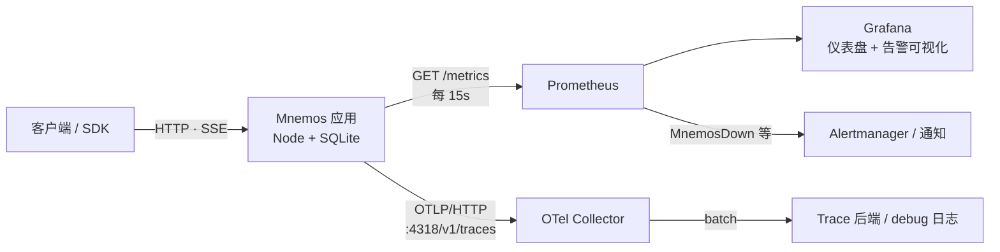

# 可观测性

> 配套文档：[运维手册](operations.md) · [架构](architecture.md) · [安全模型](security.md)
> 本地观测栈：[`deploy/observability/README.md`](../deploy/observability/README.md)

Mnemos 的可观测性由两条独立链路组成：

1. **指标（Metrics）**：进程内注册表在 `/metrics` 输出 Prometheus 文本格式，由 Prometheus 每 15s 抓取；Grafana 负责展示与告警可视化。
2. **链路（Traces）**：启用 OpenTelemetry 后，应用通过 OTLP/HTTP 将 span 推送到 Collector（默认端口 4318），由 Collector 批量导出到后端或本地日志。

两者都默认关闭或零外部依赖：不配置 `MNEMOS_OTEL_ENABLED` 时不会加载 OTel SDK，也不会发起任何网络连接。

## 1. 架构



- 指标由 **Prometheus 拉取**，不经过 Collector；即使 trace 未启用，告警与面板仍然可用。
- Trace 由应用**主动推送**到 Collector；Collector 可替换为 Tempo、Jaeger、云厂商 OTLP 端点。
- 本地栈用 `debug` exporter 把 span 打到 Collector 容器日志，仅用于验证链路。

## 2. 环境变量

| 变量 | 默认值 | 说明 |
| --- | --- | --- |
| `MNEMOS_OTEL_ENABLED` | `0` | `1`/`true` 开启 trace；关闭时不加载 SDK、不建连接、`withSpan` 直接执行原函数 |
| `MNEMOS_OTEL_ENDPOINT` | `http://127.0.0.1:4318/v1/traces` | OTLP/HTTP trace 完整路径；不要只写 `:4318` |
| `MNEMOS_OTEL_SAMPLE_RATE` | `0.1` | 0..1 的采样率；非数字回退 0.1，越界会被夹紧 |
| `MNEMOS_OTEL_SERVICE_NAME` | `mnemos` | 写入 resource `service.name`，同时作为 tracer 名称 |

启动示例（本地）：

```bash
MNEMOS_OTEL_ENABLED=1 \
MNEMOS_OTEL_ENDPOINT=http://127.0.0.1:4318/v1/traces \
MNEMOS_OTEL_SAMPLE_RATE=1 \
pnpm start
```

初始化成功会记录一条 `otel.enabled` 日志；初始化失败（依赖缺失、配置非法等）只记录
`otel.init.failed` 并降级为 no-op，进程继续启动。批量导出失败记录 `otel.export.failed`，
span 被丢弃但不影响请求处理。

## 3. 采样策略与成本

实现：`ParentBasedSampler` + `TraceIdRatioBasedSampler`（根 span 按比例采样，子 span 跟随父级决策），
等价于常见的 `ParentBasedTraceIdRatio` 语义。采样是**头部采样**（head sampling）：未采样的请求
不会产生 span，事后无法补采。

| 场景 | 建议采样率 | 说明 |
| --- | --- | --- |
| 生产常态 | `0.05` ~ `0.1` | 单实例 QPS 100 时约 5–10 span/s；成本主要取决于 span 数量与属性大小 |
| 预发 / 压测 | `0.2` ~ `0.5` | 可观察长尾，但注意 Collector/后端写入压力 |
| 排障窗口 | `1.0` | 临时全采；结束后改回，避免长期成本与噪声 |
| 关闭 | `MNEMOS_OTEL_ENABLED=0` | 无 SDK、无网络、无 CPU 采样开销 |

成本控制建议：

- 保持路由模板低基数；`/metrics` 的 `route` 已是模板（如 `/api/projects/:id/memories`），不要把原始 URL 写进标签或 span 属性。
- 不要给 span 添加大对象、密钥、完整请求体；敏感字段与日志一样按最小必要原则处理。
- 静态资源与探针流量约占空载请求的大头；当前仅忽略 `/healthz`、`/readyz`、`/metrics`、`/api/health`，
  如需进一步降本可把静态资源路径加入 `ignoreIncomingRequestHook`。
- 生产建议在 Collector 侧配置 `memory_limiter` 与持久化后端；本地 `debug` exporter 不适合长期保留。

## 4. Span 命名与属性约定

### 4.1 自动生成

| 来源 | Span 名称 | 关键属性 |
| --- | --- | --- |
| 入站 HTTP（HttpInstrumentation，`kind=SERVER`） | HTTP 方法，如 `GET`、`POST` | `http.request.method`、`url.path`、`url.query`、`http.response.status_code`、`server.address`、`network.protocol.version` |
| 出站 fetch（UndiciInstrumentation，`kind=CLIENT`） | HTTP 方法，如 `POST` | `http.request.method`、`url.full`、`url.path`、`server.address`、`server.port`、`http.response.status_code` |
| 异常 | 同一 span 的事件 `exception` | `exception.type`、`exception.message`、`exception.stacktrace`；状态置为 `ERROR` |

- 入站自动 span 不会包含业务路由模板（应用没有使用 Express/Fastify 之类的框架集成，`http.route` 为空），
  排障时用 `url.path` 定位；`mnemos_http_requests_total{route=...}` 的 `route` 标签仍是路由模板。
- 被忽略的入站路径：`/healthz`、`/readyz`、`/metrics`、`/api/health`；`/v1/*` 与 `/api/*` 均保留。
- 出站 Webhook 投递使用全局 `fetch`，会自动产生 CLIENT span；当前调度器没有把整轮投递包在自定义
  父 span 中，因此这些 span 通常是独立根 span（可按 `url.full` 与时间关联）。

### 4.2 业务自定义

`withSpan(name, attributes, fn)` 用于包裹业务关键段：

```ts
import { withSpan, currentTraceId } from './observability/otel.ts';

const results = await withSpan(
  'mnemos.memory.search',
  { 'mnemos.project_id': project.id, 'mnemos.limit': limit },
  () => engine.search(project.id, query),
);
```

约定：

- 名称使用 `mnemos.<领域>.<动作>`，如 `mnemos.memory.search`、`mnemos.webhook.deliver`；
  名称保持低基数，不要把 id、查询文本拼进名称。
- 自定义属性统一 `mnemos.` 前缀；值只允许 `string | number | boolean`，不放大对象。
- `fn` 抛错时自动 `recordException` + `setStatus(ERROR)`，随后原样抛出；不要吞异常。
- `currentTraceId()` 返回当前活动 span 的 traceId（未启用或不在 span 上下文时为 `null`），可用于把
  traceId 写进业务审计字段或响应头。

### 4.3 Resource 属性

| 属性 | 取值 |
| --- | --- |
| `service.name` | `MNEMOS_OTEL_SERVICE_NAME`（默认 `mnemos`） |
| `service.version` | `APP_VERSION`（当前 `1.1.0`） |
| `deployment.environment.name` / `deployment.environment` | `NODE_ENV`（如 `production`、`development`） |
| `host.name` | `os.hostname()` |

Collector、Grafana 与告警规则按 `service.name=mnemos` 过滤；多实例部署时用 `host.name`/`instance` 区分。

## 5. Grafana 仪表盘

文件：`deploy/grafana/dashboards/mnemos-overview.json`，由 provisioning 自动加载。
数据源 `Prometheus`（uid `prometheus`），变量 `instance`、`route`（多选，默认 All），
深色主题，30s 刷新，默认时间窗 6h。

| # | 面板 | 查询要点 | 阈值/单位 |
| --- | --- | --- | --- |
| 1 | 请求速率（route/status） | `sum by (route,status)(rate(mnemos_http_requests_total[5m]))` | reqps |
| 2 | 5xx 错误率 | 5xx / 全部 × 100，`clamp_min` 防除零 | %；2% 橙、5% 红 |
| 3 | 延迟 p50/p95/p99 | `histogram_quantile(... bucket) / 1000`，按 route | 秒；0.5s 橙、1s 红 |
| 4 | SSE 客户端 / 限流 / 429 | `mnemos_sse_clients`、`rate(mnemos_rate_limited_total)`、429 速率 | short / reqps |
| 5 | 登录失败速率 | `rate(mnemos_auth_failures_total[5m])` | reqps |
| 6 | 构建信息 / uptime | `mnemos_uptime_seconds * on(instance) group_left(version) mnemos_build_info` | 表；运行时长单位秒 |
| 7 | Webhook 投递按状态 | `sum by (status)(rate(mnemos_webhook_deliveries_total[5m]))` | reqps |
| 8 | Webhook 队列深度 | `sum(mnemos_webhook_queue_depth)` | short；50 橙、100 红 |
| 9 | Webhook 失败率 | `failed` + `dead` / 全部 × 100（10m） | %；10% 橙、20% 红 |

说明：

- 当前 `/metrics` **没有** HTTP in-flight 指标，面板 4 用 SSE 客户端数与限流/429 速率近似“进行中”视角。
- Webhook 指标由 Webhook 集成提供；若版本未包含，对应面板为空但不报错。
- 单位与阈值可按业务调整；告警规则以 `deploy/prometheus/alerts.yml` 为准。

## 6. 告警与处置 Runbook

规则文件：`deploy/prometheus/alerts.yml`，分组 `mnemos.rules`。`runbook_url` 均指向本文对应锚点；
部署到实际仓库时建议在前面补上 `https://<git-host>/<org>/mnemos/blob/main/`。

### 通用排查入口

```bash
curl -s http://127.0.0.1:4380/healthz
curl -s http://127.0.0.1:4380/readyz
curl -s http://127.0.0.1:4380/metrics | rg 'mnemos_(http_requests|rate_limited|auth_failures|webhook|maintenance)'
```

日志为 JSON（生产）或 pretty（本地），关键字段：`msg`、`method`、`path`、`status`、`latencyMs`、
`requestId`、`route`、`actor`。5xx 会以 `http.request.failed` 级别 error 输出。

<a id="mnemosdown"></a>
### MnemosDown（critical，2m）

- **含义**：Prometheus 连续 2 分钟抓不到 `up{job="mnemos"}`。
- **检查**：进程是否存活（`systemctl status`/容器状态）；`MNEMOS_HOST` 是否绑定到可被抓取的地址；
  端口 4380 与防火墙；反向代理是否拦截 `/metrics`；数据库目录是否可写。
- **止损**：重启进程；临时放开 `/metrics` 的内网访问；若磁盘满先清理 `data/backups` 旧备份。
- **恢复**：Targets 恢复 `UP` 且 `/readyz` 返回 200；核对停机期间是否产生数据缺口或未完成任务。

<a id="mnemoshigherrorrate"></a>
### MnemosHighErrorRate（warning，5xx > 2%，持续 5m）

- **含义**：5xx 占全部请求比例 > 2%。
- **检查**：Grafana 面板按 route 定位；`http.request.failed` 日志中的 `error`/`stack`；
  最近是否发布、迁移、改配置；SQLite 是否 `database is locked`；LLM/Webhook 下游是否超时。
- **止损**：回滚最近变更；提高请求超时或降级非关键功能；对故障 route 限流/摘除。
- **恢复**：错误率回落到阈值以下并保持 10 分钟；确认没有持续重试放大流量。

<a id="mnemoshighlatencyp95"></a>
### MnemosHighLatencyP95（warning，> 0.5s，持续 10m）

- **含义**：全局 p95 延迟超过 500ms。
- **检查**：面板按 route 找长尾；慢请求日志（`latencyMs > 1000` 会输出 `http.request.slow`）；
  数据库锁/大查询、备份或 VACUUM 争 I/O、磁盘 IOPS、下游模型调用。
- **止损**：避开高峰执行维护/备份；限制大分页与复杂搜索；扩容或加缓存。
- **恢复**：p95 回落并稳定 15 分钟；确认慢请求日志不再持续增长。

<a id="mnemosauthfailurespike"></a>
### MnemosAuthFailureSpike（warning，5m 内 > 20 次）

- **含义**：鉴权失败次数异常升高，可能是凭据轮换、暴力破解或客户端配置错误。
- **检查**：审计日志中的来源 IP/actor；`mnemos_auth_logins_total{result="failure"}`；
  登录锁定是否触发；API Key 前缀是否正确。
- **止损**：在反向代理/WAF 封禁来源；通知客户端更新密钥；必要时临时降低登录尝试上限。
- **恢复**：失败速率回落到基线；确认合法客户端已恢复；轮换泄露密钥并审计访问。

<a id="mnemosratelimitedspike"></a>
### MnemosRateLimitedSpike（warning，5m 内 > 10 次）

- **含义**：限流器拒绝的请求明显增多。
- **检查**：面板按 route 查看 429 分布；是否存在单客户端突发轮询、错误重试风暴或攻击；
  当前限流阈值是否与业务峰值匹配。
- **止损**：封禁异常来源；与调用方协调退避；临时提高该 route 配额（记录变更）。
- **恢复**：429 速率回落；确认没有业务请求被长期拒绝；复盘容量与配额。

<a id="mnemoswebhookfailures"></a>
### MnemosWebhookFailures（warning，10m 失败率 > 20%）

- **含义**：`failed`（可重试）+ `dead`（超过最大重试）占全部投递超过 20%。
- **检查**：面板按状态拆分；投递日志中的目标 URL、HTTP 状态、超时；订阅方是否下线；
  SSRF 白名单/签名密钥是否变更；`dead` 投递是否需要人工补投。
- **止损**：暂停问题订阅；修正目标 URL/密钥；对目标端限流做退避；必要时手动重放 `dead` 投递。
- **恢复**：失败率 < 10% 持续 15 分钟；确认队列没有继续堆积；与订阅方核对事件完整性。

<a id="mnemoswebhookqueuebacklog"></a>
### MnemosWebhookQueueBacklog（warning，队列 > 100，持续 10m）

- **含义**：待投递任务持续堆积，worker 吞吐不足或目标端响应慢。
- **检查**：`mnemos_webhook_queue_depth` 曲线；worker 是否运行；目标端 p95 延迟/限流；
  `webhookWorkerIntervalMs` 与最大重试配置；数据库写入是否被锁。
- **止损**：停止非关键订阅；提高 worker 并发/缩短超时；隔离慢目标；必要时扩容。
- **恢复**：队列回落到 0 附近并保持；确认没有死信累积；补投遗漏事件。

<a id="mnemosmaintenancefailure"></a>
### MnemosMaintenanceFailure（warning，6h 内有失败）

- **含义**：`mnemos_maintenance_runs_total{status="failed"}` 增长，维护任务失败。
- **检查**：`/api/ops/maintenance?limit=20` 的失败记录与 `error`；日志 `maintenance.*`；
  数据目录/备份目录权限与磁盘空间；数据库锁或损坏。
- **止损**：修复目录权限/清理磁盘；手动触发一次维护确认可执行；必要时从备份恢复。
- **恢复**：连续至少一次维护成功；核对备份文件可读；记录失败根因。

> 维护指标在任务实际运行后才会出现；若部署版本没有该指标，本告警不会触发，可忽略。

## 7. 与日志的关联

| 标识 | 产生位置 | 用途 |
| --- | --- | --- |
| `x-request-id` | 入站中间件生成/复用，响应头返回 | 一次 HTTP 请求的日志主键；客户端可自带合法 id 透传 |
| `requestId` | 每条 `http.request*` 日志字段 | 按请求检索日志 |
| traceId | 当前 span 的 `traceId`（32 位十六进制） | 在 Collector/后端按 trace 查看完整调用链 |

请求头透传：应用接受 W3C `traceparent`，上游网关/服务注入后可与本服务链路串联。

```bash
# 从采集端按 traceId 查（以 Tempo/Jaeger 为例，具体命令按后端调整）
# 本地 debug collector 可直接在日志中搜索 traceId
docker compose -f deploy/observability/docker-compose.yml logs otel-collector | rg '<traceId>'
```

**已知缺口**：当前结构化日志**没有注入 traceId**。日志与 trace 的关联需要：

1. 在响应头/审计字段中带 `currentTraceId()`（业务代码可主动写）；或
2. 后续在 HTTP 中间件中把 `trace.getActiveSpan()?.spanContext().traceId` 加入日志字段。

在补齐前，跨系统排障建议用 `x-request-id` + 时间窗 + route 在日志侧定位，再在 trace 后端按时间/路由筛选。

## 8. 已知限制

- **只有 trace**：未实现日志 OTLP 导出与 OTel metrics 导出；指标仍由 `/metrics` 拉取。
- **无 profiling / 连续剖析**：CPU/内存问题需依赖系统工具或 Node inspector。
- **无路由模板属性**：自动入站 span 名称为 HTTP 方法，`http.route` 为空；路由模板只在指标标签中。
- **头部采样**：未采样请求无法事后补采；无 tail sampling。
- **单节点假设**：无 Collector HA、无跨实例 trace 聚合；`instance` 变量用于区分，但本地栈只抓一个目标。
- **导出失败即丢弃**：只记录 `otel.export.failed`，不落本地磁盘、不重试到持久队列。
- **Webhook 指标可能缺失**：旧版本或未启用 Webhook 时，相关面板为空、告警不触发。
- **本地栈未真机验证**：当前开发机没有 Docker，`deploy/observability` 的 Compose 仅做配置自检。

## 9. 相关文件

| 文件 | 用途 |
| --- | --- |
| `server/src/observability/otel.ts` | OTel 初始化、`withSpan`、`currentTraceId`、测试注入 |
| `server/src/observability/tracing.test.ts` | 关闭/启用/异常路径单测 |
| `deploy/grafana/provisioning/` | Prometheus 数据源与仪表盘自动加载 |
| `deploy/grafana/dashboards/mnemos-overview.json` | Mnemos Overview 面板 |
| `deploy/prometheus/prometheus.yml` | 抓取配置（15s） |
| `deploy/prometheus/alerts.yml` | `mnemos.rules` 告警规则 |
| `deploy/observability/docker-compose.yml` | 本地 Prometheus + Grafana + Collector |
| `deploy/observability/otel-collector.yaml` | OTLP 接收、batch、debug 导出 |
