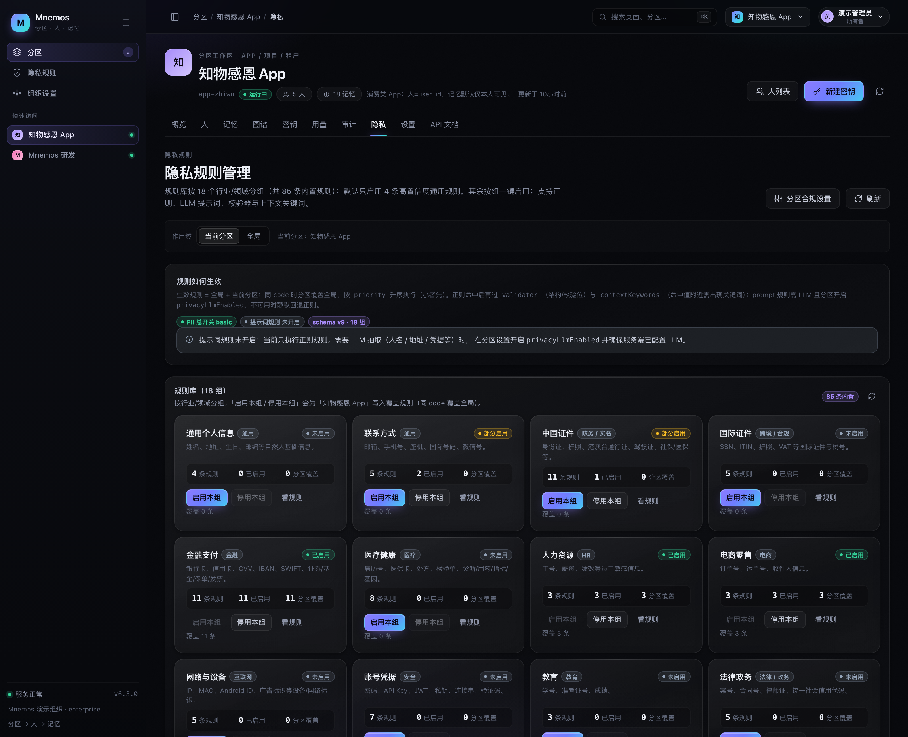

# 隐私规则域（v6.3 / schema v9）

> 目标：把「PII 脱敏」从写死的 `basic` 逻辑升级为可维护的规则域：
> **全局规则 + 分区规则**，每类规则支持 **正则（直接扫描）** 与 **提示词（LLM 抽取）**；
> 写入支持 **占位符 + 映射表** 的隐私抽离协议；记忆整理（dream/consolidation）同时执行规则与 LLM 隐私抽取。
>
> **v6.3 新增「隐私规则库」**：18 个行业/领域分组、85 条内置规则、15 种结构校验器、
> 上下文关键词与大小写控制，以及**整组启停**（分区覆盖）。目录见
> [`privacy-catalog.md`](privacy-catalog.md)（由 `server/src/db/privacy-catalog.ts` 生成）。
>
> **实现状态（v6.3）**：schema v9 的 `privacy_rules`（新增 `group_key` / `validator` /
> `context_keywords` / `case_sensitive` / `region` / `severity`）与 `privacy_rule_groups` 已落地；
> 规则 CRUD / 分组启停 / preview / rescan / 占位符 reveal 端点按本文与 [`api.md`](api.md) 第 6 节实现。
> 默认只启用 4 条高置信度通用规则，其余按组启用。

## 1. 模型

```ts
type PrivacyRuleScope = 'global' | 'partition';
type PrivacyRuleKind = 'regex' | 'prompt';
type PrivacyAction = 'mask' | 'placeholder';
type PrivacyMaskMode = 'email' | 'keepFirstLast' | 'keepLast' | 'full';
type PrivacySeverity = 'low' | 'medium' | 'high';

interface PrivacyRule {
  id: string;
  scope: PrivacyRuleScope;
  partitionId?: string;      // global 规则为空
  code: string;              // email/phone/id_card/person_name/...（v6.3 起 name→person_name、medical→diagnosis）
  name: string;
  kind: PrivacyRuleKind;
  pattern?: string;          // regex 源码
  flags?: string;            // 默认 'g'
  instruction?: string;      // prompt：告诉 LLM 抽取什么
  entityType: string;        // email/phone/name/...
  action: PrivacyAction;     // mask（默认）| placeholder
  maskMode: PrivacyMaskMode;
  maskKeepLast: number;      // 默认 4
  maskKeepFirst: number;     // 默认 0
  enabled: boolean;
  priority: number;          // 小者先执行，默认 100
  builtin: boolean;
  /* --- v6.3（schema v9）--- */
  groupKey: string;          // 所属规则库分组（默认 'common'）
  validator: string;         // 结构/校验位校验器，'none' 表示不校验
  contextKeywords: string[]; // 命中值附近需出现其一（32 字符窗口，大小写不敏感）
  caseSensitive: boolean;    // false 时正则补 i 标志
  region: string;            // 'global' | 'US' | 'EU' …（业务标注，不参与扫描）
  severity: PrivacySeverity; // 元数据（UI 排序/告警），不改变扫描行为
  createdAt: string;
  updatedAt: string;
}
```

### 1.1 规则合并

- 生效规则 = `global` 规则 + 该分区 `partition` 规则。
- 同 `code` 时分区规则覆盖全局规则（可改 pattern/instruction/action/enabled/validator/context…）。
- 按 `priority` 升序执行；同 code 只保留一条。
- 全局内置规则库（v6.3）：`server/src/db/privacy-catalog.ts` 的 **18 组 / 85 条**，由 `seedPrivacyRules()`
  幂等写入 `scope=global, builtin=1`；其中只有 4 条默认启用：
  `email` / `id_card` / `phone` / `bank_card`（regex）。
- 其余 81 条默认 `enabled=false`，按**分组**启用（见 1.3）；17 条 `kind=prompt` 还额外要求
  `privacyLlmEnabled=true` 且 LLM 可用。
- 自定义规则：任意 `code`（`^[a-z0-9_]{2,40}$`）可归入某个 `groupKey`，不要求属于内置目录。

### 1.2 PrivacyRuleGroup

```ts
interface PrivacyRuleGroup {
  key: string;          // common/contact/identity_cn/...（`privacy_rule_groups.key`）
  name: string;         // 展示名
  industry: string;     // 行业/领域
  description: string;
  sortOrder: number;
  builtin: boolean;
  ruleCount: number;    // 该组全局规则数（目录条数）
  enabledCount: number; // 当前分区生效且 enabled 的条数（含全局默认启用 + 分区覆盖）
  appliedCount: number; // 当前分区显式覆盖条数（scope=partition 且 group_key=该组）
}
```

- 计数定义（`GET` 单组 / 列表 / apply 返回的 `group` 一致）：
  - `ruleCount` = 该组全局规则数（固定，18 组合计 85）；
  - `enabledCount` = 该分区生效启用数：全局 enabled 且未被分区覆盖 + 分区覆盖 enabled，
    **只统计与全局同 code 的规则**（分区自定义规则不计入）；
  - `appliedCount` = 该分区对该组全局规则的分区覆盖条数（存在分区规则即计 1，无论其 enabled true/false）。
  - 未传分区（`GET /api/privacy/groups` 省略 `partitionId`）时按全局统计：`enabledCount` = 全局启用数，
    `appliedCount` = 0。
- 默认启用规则计入 `enabledCount`，但不是分区覆盖；对某组执行「启用本组」后，该组每条规则都产生
  分区覆盖，`appliedCount` 才会随之增加。
- 分组本身不带 `enabled` 开关，启用状态完全由组内每条规则的 `enabled` 表达（避免「组开关」与
  「单条规则开关」两套状态冲突）。

### 1.3 规则库分组与整组启停

- 目录固定 18 组（`common` / `contact` / `identity_cn` / `identity_intl` / `finance` /
  `healthcare` / `hr` / `ecommerce` / `internet` / `credentials` / `education` / `legal` /
  `automotive` / `location` / `biometric` / `crypto` / `telecom` / `realestate`）；
  组与规则的完整列表见 [`privacy-catalog.md`](privacy-catalog.md)。
- **整组启用**（`enabled=true`）：对该组每条全局规则，在当前分区 upsert 一条
  `scope=partition` 的覆盖规则并设 `enabled=true`；已存在同 code 分区覆盖则只改 `enabled`。
- **整组停用**（`enabled=false`）：同样 upsert 覆盖并设 `enabled=false`（不删除规则）。
  默认启用但被整组停用的规则（如停用 `contact`）会被分区覆盖禁用。
- 整组启停**幂等**：重复执行结果一致；只影响当前分区，不修改全局目录，也不影响其他分组；
  已存在的自定义规则（非目录 code）不受影响。
- 组内单条规则仍可单独 `PATCH enabled`；之后再次整组启用/停用会统一覆盖该组所有规则。
- `appliedCount` 用于 UI 展示「本组已覆盖 N/M 条」，`enabledCount` 展示实际生效条数。
- **API**：
  - `GET /api/privacy/groups?partitionId=`（控制台登录；带 `partitionId` 时需该分区 viewer+，省略时按全局统计）
  - `POST /api/privacy/groups/:key/apply` body `{ partitionId | partition_id, enabled }`（分区 admin）
  - `GET /v1/partitions/:p/privacy/groups`（`memories:read`）
  - `POST /v1/partitions/:p/privacy/groups/:key/apply` body `{ enabled }`（`admin`）
- **UI**：控制台隐私规则页的「规则库 / 分组」视图：18 个分组卡片（名称/行业/说明/规则数/
  生效数/覆盖数）+「启用本组 / 停用本组」，规则列表按组筛选并可搜索 code/name。
- 审计：整组启停写 `audit_logs.action = 'privacy.group.apply'`，detail `{group, enabled, count}`。

### 1.4 开关

- 总开关沿用 `partition.settings.piiRedaction: 'off' | 'basic'`（默认 off）；`basic` 时执行规则。
- `partition.settings.privacyLlmEnabled: boolean`（默认 false）：是否执行 prompt 规则
  （需配置 LLM；失败静默回退 regex）。
- 显式提交 `placeholders` 映射时，即使总开关 off 也保存（调用方主动抽离）。
- 启用状态按「合并后的生效规则」判断：全局 enabled + 分区覆盖后的最终 `enabled` 才参与扫描。

## 2. 扫描与替换

### 2.1 规则过滤与顺序

对合并后的每条规则依次判断：

1. `enabled=true`；
2. `kind=regex` 需要 `pattern` 可编译；`kind=prompt` 需要 `privacyLlmEnabled` + LLM；
3. 正则命中后，若 `validator !== 'none'`，调用校验器；**不通过则该命中被跳过**（不会降级保留）；
4. 若配置了 `contextKeywords`，命中值前后 **32 字符**窗口内必须出现至少一个关键词
   （匹配时大小写不敏感）；
5. `caseSensitive=false` 时为正则补 `i` 标志（与规则自身 `flags` 合并、去重）；
6. 按 `priority` 升序执行；已被替换/占位的片段不会被后续规则重复命中。

`region` 与 `severity` 只作展示/排序/告警，**不参与过滤**；是否处理只由 `enabled` 决定。

### 2.2 正则规则

- 按 priority 顺序执行；已替换的片段（`*` 或 `{{token}}`）不会被后续规则重复命中。
- `mask`：按 maskMode 打码；
  - `email`：`a***@domain`
  - `keepFirstLast`：前 N + `*` + 后 M（身份证 6/4、手机 3/4）
  - `keepLast`：`*` + 后 4
  - `full`：全 `*`
- `placeholder`：生成 `{{pii_<random8>}}`（同一值复用同一占位符），并记录映射。
- 无 validator / 无 contextKeywords 的规则完全依赖 pattern；高误报风险清单与建议见
  [`privacy-catalog.md`](privacy-catalog.md#误报边界与调优建议)。

### 2.3 提示词规则（LLM）

- 仅在 `privacyLlmEnabled` 且 LLM 可用时执行。
- 把启用的 prompt 规则（code + instruction）与文本交给 LLM，要求返回：
  ```json
  {"entities":[{"code":"name","value":"张三"},{"code":"address","value":"..."}]}
  ```
- 服务端校验 value 确实出现在文本中（防幻觉），按对应规则的 action/mask 替换。
- 异步执行：写入/更新入队 `privacy` job；dream 整理时同步对输入记忆执行一次（LLM 可用时）。
- 记录 `memories.privacy_scanned_at`，避免重复扫描；规则/分组变更后可重扫（管理端点）。

## 3. 校验器、上下文与大小写

### 3.1 校验器列表

`validator` 取值（`none` 表示不校验）。实现位于 `server/src/lib/validators.ts`，统一导出
`validateValue(validator, value): boolean`：

| validator | 语义 |
| --- | --- |
| `none` | 不校验（默认） |
| `luhn` | Luhn 校验位（银行卡 / 信用卡 / IMEI） |
| `cn_id` | GB 11643 身份证：18 位 + 校验位 + 出生日期合法性 |
| `us_ssn` | 美国 SSN 结构（区段/重复位） |
| `us_itin` | 美国 ITIN 结构（9xx-7x/8x） |
| `iban` | IBAN mod-97 |
| `vin` | VIN 17 位 + 第 9 位校验码 |
| `ipv4` | IPv4 点分十进制合法性 |
| `ipv6` | IPv6 地址合法性（`node:net`） |
| `mac` | MAC 地址 6 段十六进制 |
| `jwt` | JWT 三段结构 + header 可解析 |
| `uscc` | 统一社会信用代码 mod-31 |
| `eth` | ETH 地址 `0x` + 40 hex |
| `btc` | BTC 地址 Base58Check |
| `coordinates` | 经纬度范围（-90..90 / -180..180） |
| `uuid` | UUID 8-4-4-4-12 结构 |

规则与校验器的对应关系见 [`privacy-catalog.md`](privacy-catalog.md)。

### 3.2 上下文关键词与大小写

- `contextKeywords` 为字符串数组（DB 列 `context_keywords`，JSON 文本）。
- 命中值前后各取 **32 个字符**的窗口，窗口内出现任一关键词才算命中；关键词比较大小写不敏感。
- 典型用途：给纯数字/短串规则加锚（邮编、座机、工号、订单号、病例号、CVV、OTP…），
  以 pattern + 上下文两级收敛误报。
- `caseSensitive`（DB 列 `case_sensitive`，默认 `1`）：`false` 时引擎给正则补 `i` 标志；
  目录内没有默认 `false` 的规则，`employee_id` / `bearer_token` / `database_url` 通过 `flags=gi`
  实现大小写不敏感。
- 自定义规则可同时设置 `validator`、`contextKeywords`、`caseSensitive`、`region`、`severity`。

### 3.3 校验器与语义

- 校验器在正则命中**之后**执行；输入是命中的原始值（未打码）。
- 返回 `false` 只跳过这一条命中，不影响同文本的其他规则；不会报错、不会阻塞写入。
- 校验器只做结构与校验位判断，不判断业务语义（例如「这串号码是否属于当前用户」）。
- 没有校验器的规则（目录内 68 条）依赖 pattern + contextKeywords；新增此类规则时建议：
  1) 用 `contextKeywords` 限定语境；2) 先 `preview` 真实样本；3) 再按分区启用。

## 4. 占位符协议（写入抽离）

请求示例：

```json
{
  "content": "张三的手机号是 {{phone_a1b2}}，邮箱是 {{mail_c3d4}}。",
  "placeholders": {
    "phone_a1b2": "18334423321",
    "mail_c3d4": "zhangsan@example.com"
  }
}
```

- token 格式 `{{key}}`，key 为 `[A-Za-z0-9_-]{3,64}`。
- 每个 token 必须有映射；映射中存在但正文未使用 → 忽略。
- 值存入 `memory_placeholders`（AES-256-GCM，密钥 `MNEMOS_ENCRYPTION_KEY`；未配置时明文并标 `encrypted=0`）。
- 记忆正文只保存 token（不落明文）；`metadata.placeholderCount`。
- 读取：
  - 列表/搜索只返回 `placeholderCount`；
  - 详情默认返回 keys（`placeholders:[{placeholder,kind,encrypted}]`）；
  - `?reveal=placeholders`（或 `reveal=true`）返回解密值，需 `memories:read`；
  - `brief/context` 在服务端把 token 替换为真实值后再生成提示词（否则 LLM 无法使用）。
- 工具 / SDK 文档已同步（写入前抽离）：
  - DSH 插件 `mnemos_add`：schema 含 `placeholders`（`additionalProperties: string`），description 给出示例；
    系统提示段同时提示该协议。
  - MCP `mnemos_add`：同一 `placeholders` 字段与示例，原样透传到写接口。
  - TS SDK `MemoryInput.placeholders`；Python `memories.add(placeholders=...)`。
  - REST：`POST /v1/partitions/:p/persons/:person/memories` 的 body 接受 `content` / `text` + `placeholders`。

## 5. 记忆整理（dream）

`dream` 批次内对每条输入记忆：

1. 规则扫描（regex，始终）；
2. LLM 抽取（prompt 规则，开启且 LLM 可用）；
3. 有变更则更新 content/placeholders，写 `memory_history`（event=`PRIVACY`），`privacy_scanned_at=now`；
4. dream 结果统计 `privacyRedacted`（命中条数/替换数），写入 summary。

## 6. API

```
GET    /api/privacy/groups?partitionId=                        # 分组 + 计数
POST   /api/privacy/groups/:key/apply                          # {partitionId, enabled} 整组启停
GET    /api/privacy/rules?scope=global|partition&partition_id=&group_key=   # 读（支持按组过滤）
POST   /api/privacy/rules                                      # 建（global=owner，partition=admin）
PATCH  /api/privacy/rules/:id
DELETE /api/privacy/rules/:id
POST   /api/privacy/preview    {partitionId, text}             # 试跑（不落库）
GET    /v1/partitions/:p/privacy/groups                        # v1 分组
POST   /v1/partitions/:p/privacy/groups/:key/apply             # v1 整组启停
GET    /v1/partitions/:p/privacy/rules                         # v1 读（合并后的生效规则）
GET    /v1/partitions/:p/memories/:id?reveal=placeholders      # 占位符映射（详情）
POST   /api/partitions/:p/privacy/rescan {person_id?,limit?}   # 重扫（admin）
POST   /api/ops/jobs/tick                                      # 已有
```

权限：console 读 viewer+；规则/分组写 admin+；global 规则 owner；v1 读 `memories:read`、写 `admin`。

### 6.1 请求 / 响应要点

- 命名：`/api` 为 camelCase（`partitionId` / `groupKey` / `contextKeywords` / `caseSensitive` /
  `createdAt`）；`/v1` 为 snake_case（`partition_id` / `group_key` / `entity_type` / `created_at`）。
  两套是同一能力；请求体两种命名都接受（`partitionId` 或 `partition_id`）。
- 分组列表（`GET /api/privacy/groups?partitionId=…`，省略 `partitionId` 时返回全局统计，节选）：

  ```json
  {
    "items": [
      {
        "key": "contact",
        "name": "联系方式",
        "industry": "通用",
        "description": "邮箱、手机号、座机、国际号码、微信号。",
        "sortOrder": 20,
        "builtin": true,
        "ruleCount": 5,
        "enabledCount": 2,
        "appliedCount": 0
      }
    ]
  }
  ```

  `/v1` 同路径字段为 snake_case：`sort_order` / `rule_count` / `enabled_count` / `applied_count`。

- 整组启停（`POST /api/privacy/groups/contact/apply`）：

  ```bash
  curl -s -X POST "$BASE/api/privacy/groups/contact/apply" \
    -H "authorization: Bearer $SESSION" -H 'content-type: application/json' \
    -d '{"partitionId":"ptn_2c3dcb0f511c4c81","enabled":true}'
  ```

  请求体同时接受 `partitionId` 与 `partition_id`；`enabled` 可省略，**默认 `true`**；缺分区 400，
  未知 group key 404；重复调用幂等。响应 `{ group: PrivacyRuleGroup, items: PrivacyRule[] }`：
  `items` 是该分区该组**应用后的生效规则**（global + partition 合并、按 priority 排序，含
  `enabled=false` 的规则，便于 UI 展示）；`group` 是应用后的组计数（同 GET 单组形状）。
  `/v1/partitions/:p/privacy/groups/:key/apply` 返回同样的 `{ group, items }`，字段为 snake_case，
  权限 `admin`。审计 `privacy.group.apply`，detail `{group, enabled, count}`。
- 规则列表支持 `group_key` / `groupKey` 过滤（分区规则视图与全局视图均可）。
- 规则对象新增字段（camelCase / snake_case）：

  | `/api` | `/v1` | 类型 | 说明 |
  | --- | --- | --- | --- |
  | `groupKey` | `group_key` | string | 所属分组 |
  | `validator` | `validator` | string | 校验器，默认 `none` |
  | `contextKeywords` | `context_keywords` | string[] | 上下文关键词 |
  | `caseSensitive` | `case_sensitive` | boolean | 默认 `true` |
  | `region` | `region` | string | 默认 `global` |
  | `severity` | `severity` | `low\|medium\|high` | 默认 `medium` |

- 预跑 `POST /api/privacy/preview` 请求 `{partitionId, text}`，响应 `PrivacyScanResult`：

  ```json
  {
    "text": "联系 138****8000 或 z***@example.com",
    "redacted": true,
    "hits": [
      { "code": "phone", "entityType": "phone", "value": "13800138000", "start": 3, "end": 14, "action": "mask" }
    ],
    "placeholders": {}
  }
  ```

  `hits[].start/end` 是替换前原文中的偏移；`action=placeholder` 时 `placeholders` 返回
  `{ "{{token}}": "真实值" }`，但 preview **不落库**、也不建立映射。
- 记忆详情 `GET /v1/partitions/:p/memories/:id?reveal=placeholders` 在 `{memory, person}` 之外返回：

  ```json
  "placeholders": [
    { "placeholder": "phone_a1b2", "kind": "phone", "encrypted": true, "value": "18334423321" },
    { "placeholder": "mail_c3d4", "kind": "email", "encrypted": true, "value": "zhangsan@example.com" }
  ]
  ```

  不带 `reveal` 时同样返回数组，但每项只有 `{placeholder, kind, encrypted}`，不含 `value`。
  列表 / 搜索永不返回 `placeholders`，只有 `placeholder_count` / `metadata.placeholderCount`。
- `POST /api/partitions/:p/privacy/rescan` 可选 `person_id` 缩小范围、`limit` 限制单批数量，
  返回扫描 / 变更计数；也可用 `POST /api/ops/jobs/tick` 让 `privacy` job 立即跑一批。
- 规则写操作对 `builtin=true` 的全局规则：允许 `PATCH`（覆盖 / 禁用）但拒绝 `DELETE`
  （提示改为 `enabled=false`）。
- 分区规则 / 分组不能跨分区访问：`:partition` 不匹配时统一 `404 NOT_FOUND`；org 级 global 规则读需
  是组织成员，写需 `owner`。

---

## 7. 实现与限制

### 7.1 已落地的数据结构（schema v9）

- `privacy_rule_groups`：18 组。列 `key`（主键）、`name`、`industry`、`description`、`sort_order`、
  `builtin`、`created_at`、`updated_at`；启动时从 catalog 幂等 upsert。
- `privacy_rules`：`UNIQUE(scope, partition_id, code)`；`partition_id` 在 global 规则里为空串。
  v9 新增列：`group_key`（默认 `'common'`）、`validator`（默认 `'none'`）、`context_keywords`
  （JSON 文本，默认 `'[]'`）、`case_sensitive`（默认 `1`）、`region`（默认 `'global'`）、
  `severity`（默认 `'medium'`）；索引 `idx_privacy_rules_group(scope, partition_id, group_key)`。
  列名 snake_case，HTTP 层转换为 camelCase（`/api`）或 snake_case（`/v1`）。
- `memory_placeholders`：`UNIQUE(memory_id, placeholder)`；`value_cipher` + `encrypted`。
  `kind` 记录来源实体类型（可为空）。
- `memories.privacy_scanned_at`：扫描时间；`memory_jobs.type` 含 `privacy`。
- `meta.schema_version = 9`。

### 7.2 v8 → v9 迁移

- 启动时 `migrate()` 对旧库先 `ensureColumns` 补列（`privacy_rules` 六个新列），再执行
  `schema.sql` 建 `privacy_rule_groups` 与索引，最后 `seedPrivacyRules()` 幂等写入目录。
- 旧内置 code 迁移：`name → person_name`、`medical → diagnosis`（`UPDATE OR IGNORE`；
  若目标 code 已存在则保留原行，避免唯一键冲突）。
- 既有分区覆盖与自定义规则**保留**；新增字段取默认值（`group_key='common'` 等）。
  旧分区覆盖若分组字段不准（如 finance 的覆盖仍标 `common`），可用 `PATCH` 修正 `groupKey`；
  整组启停只更新已有覆盖的 `enabled`，不会改写其 `group_key`。
- 内置规则的目录字段（name/kind/pattern/instruction/entityType/mask/priority/groupKey/validator/
  context/region/severity）每次启动按 catalog 同步；`enabled` / `action` 等管理端可改项保留。
- 迁移幂等：可重复启动；升级前建议备份（schema 已变化，回滚代码需先恢复备份）。

### 7.3 限制（重要）

- **加密是可选项**：`MNEMOS_ENCRYPTION_KEY` 未配置时 `value_cipher` 存明文且 `encrypted=0`。
  这只适合本地开发；生产必须配置，否则占位符映射等于明文库。记忆正文本身不加密（保护 FTS），
  安全性依赖「正文只存 token」。
- **LLM 失败静默**：prompt 规则在 LLM 不可用 / 超时 / 输出非 JSON 时静默跳过；不会因为隐私抽取
  失败而让写入失败（与 v6.1 的「写入不依赖 LLM」一致）。
- **prompt 抽取有防幻觉校验**：LLM 返回的 `value` 必须能在原文中定位到，否则忽略该条；避免把
  未出现的值替换进正文。
- **是异步任务**：写入后的规则扫描由 `privacy` job 异步执行（worker tick）；刚写入的记忆可能短暂
  未脱敏。`privacy_scanned_at` 防重复；规则/分组变更后要 `rescan` 才会影响历史记忆。
- **只处理文本**：本版规则只扫描 `content` / messages 拼接后的正文；附件 `caption` 与附件 URL
  不在扫描范围。
- **占位符 key 由调用方负责**：服务端只校验 `[A-Za-z0-9_-]{3,64}` 与「token 必须有映射」；
  同一 token 在一次写入中只能映射到一个值（映射是对象）。
- **内置规则不可删**：`builtin=true` 只能覆盖 / 禁用；自定义规则按 `code` 去重，同 code 分区规则
  覆盖全局规则。
- **整组启停是分区级覆盖**：不是全局开关，也不改变 catalog；组内规则仍可单独改。反复启停只改
  `enabled`，不会删除覆盖行。
- **validator/context 只影响命中**：不会修改文本；不通过 = 该条规则对该片段不生效。上下文窗口
  固定 32 字符，跨句/跨段关键词不算命中。
- **brief/context 会还原真实值**：因此这两个接口的输出本身包含 PII，调用方需按敏感数据保护；
  列表 / 搜索 / 导出保持 token 或计数。
- **审计**：规则增删改、分组启停（`privacy.group.apply`）、占位符 reveal 在审计开启时记录；
  审计内容不包含真实值。

### 7.4 与旧 `basic` 的关系

- `pii_redaction=off`：只有显式 `placeholders` 生效。
- `pii_redaction=basic`：执行生效的 regex 规则（4 条默认启用 + 分组/分区覆盖）；
  仍写 `metadata.piiRedacted=true` 与 `memory.pii_redacted` 审计。
- `privacyLlmEnabled=true` 且 LLM 可用：在 regex 之后执行 prompt 规则。
- 旧的写死 `basic`（手机 / 邮箱 / 身份证 / 银行卡）语义由 4 条默认启用的 regex 规则保留，行为兼容；
  v6.3 只是把其余规则从「不存在」变成「按组可启用」。

---

## 8. 验收

- 目录：18 组 / 85 条；默认启用仅 `email` / `id_card` / `phone` / `bank_card`；`name→person_name`、
  `medical→diagnosis` 迁移生效。
- 规则分组字段（groupKey/validator/contextKeywords/caseSensitive/region/severity）在 /api 与 /v1
  读写、序列化一致。
- 整组启停：启用 `contact` 后 `enabledCount`/`appliedCount` 增加，禁用后生效条数回落；
  重复调用幂等；审计有 `privacy.group.apply`。
- 校验器：每个 validator 正反例；`contextKeywords` 命中/不命中（32 字符窗口）；`caseSensitive=false`
  可命中大小写变体。
- 扫描：`basic` + 自定义 regex（如「工号」`EMP-\d{6}`）写入命中并打码；prompt 规则（fake LLM）
  抽取姓名/诊断并打码；LLM 不可用回退规则。
- 占位符写入：正文落 token、映射加密存储、`reveal` 可解密、`brief/context` 已替换真实值、列表只有计数。
- dream：输入记忆被规则+LLM扫描，history 有 `PRIVACY`，summary 有统计。
- 控制台：隐私规则页的「规则库/分组」视图（18 组、计数、整组启停）、规则编辑器新字段、
  preview；记忆抽屉显示占位符/映射（reveal）。
- 文档：`docs/privacy-catalog.md`、`docs/privacy-rules.md`、`docs/api.md`、`docs/architecture.md`、
  README 同步。

---

## 9. 文档与工具同步（v6.3）

| 位置 | 变更 |
| --- | --- |
| [`privacy-catalog.md`](privacy-catalog.md) | 新增：18 组 / 85 条规则目录、校验器映射、默认策略、误报边界 |
| [`api.md`](api.md) 第 6 节 | 分组端点（groups/apply）、规则新字段、分组示例、schema v9 |
| [`architecture.md`](architecture.md) | `privacy_rule_groups`、validator/context/case 扫描流程、分组覆盖语义 |
| `docs/privacy-rules.md` | 本文：分组模型、整组启停、校验器/上下文、v8→v9 迁移 |
| `integrations/dsh-mnemos-personal` / `mcp-mnemos` | `mnemos_add` 的 `placeholders` 协议（v6.2 已有，v6.3 不变） |
| `sdk/typescript` / `sdk/python` | 占位符参数（v6.2 已有，v6.3 不变） |
| 根 `README.md` | 功能总览新增「隐私规则库（18 组 / 85 条 / 校验器 / 整组启停）」；版本 6.3.0 / schema v9 |

## 10. 界面截图



