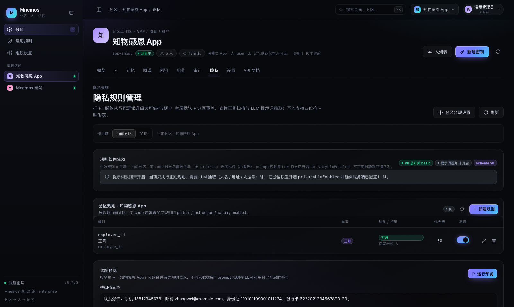
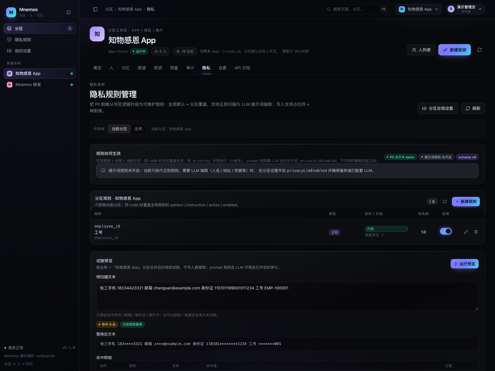

# 隐私规则域（v6.2 / schema v8）

> 目标：把「PII 脱敏」从写死的 `basic` 逻辑升级为可维护的规则域：
> **全局规则 + 分区规则**，每类规则支持 **正则（直接扫描）** 与 **提示词（LLM 抽取）**；
> 写入支持 **占位符 + 映射表** 的隐私抽离协议；记忆整理（dream/consolidation）同时执行规则与 LLM 隐私抽取。
>
> **实现状态（v6.2）**：schema v8 的 `privacy_rules` / `memory_placeholders` 已落地；HTTP 端点与
> 引擎按本文契约实现。接口形状以本文与 [`api.md`](api.md) 第 6 节为准；联调后如有调整会同步。

## 1. 模型

```ts
type PrivacyRuleScope = 'global' | 'partition';
type PrivacyRuleKind = 'regex' | 'prompt';
type PrivacyAction = 'mask' | 'placeholder';
type PrivacyMaskMode = 'email' | 'keepFirstLast' | 'keepLast' | 'full';

interface PrivacyRule {
  id: string;
  scope: PrivacyRuleScope;
  partitionId?: string;      // global 规则为空
  code: string;              // email/phone/id_card/bank_card/name/address/...
  name: string;
  kind: PrivacyRuleKind;
  pattern?: string;          // regex 源码
  flags?: string;            // 默认 'g'
  instruction?: string;      // prompt：告诉 LLM 抽取什么
  entityType: string;        // email/phone/name/...
  action: PrivacyAction;     // mask（默认）| placeholder
  maskMode: PrivacyMaskMode;
  maskKeepLast: number;      // 默认 4
  maskKeepFirst: number;     // 默认 0
  enabled: boolean;
  priority: number;          // 小者先执行，默认 100
  builtin: boolean;
  createdAt: string;
  updatedAt: string;
}
```

### 1.1 规则合并

- 生效规则 = `global` 规则 + 该分区 `partition` 规则。
- 同 `code` 时分区规则覆盖全局规则（可改 pattern/instruction/action/enabled）。
- 按 `priority` 升序执行；同 code 只保留一条。
- 全局内置：`email / id_card / phone / bank_card`（regex，默认启用）；`name / address / credential / medical`（prompt，默认禁用，分区按需开启并需配置 LLM）。

### 1.2 开关

- 总开关沿用 `partition.settings.piiRedaction: 'off' | 'basic'`（默认 off）；`basic` 时执行规则。
- `partition.settings.privacyLlmEnabled: boolean`（默认 false）：是否执行 prompt 规则（需配置 LLM；失败静默回退规则）。
- 显式提交 `placeholders` 映射时，即使总开关 off 也保存（调用方主动抽离）。

## 2. 扫描与替换

### 2.1 正则规则

- 按 priority 顺序执行；已替换的片段（`*` 或 `{{token}}`）不会被后续规则重复命中。
- `mask`：按 maskMode 打码；
  - `email`：`a***@domain`
  - `keepFirstLast`：前 N + `*` + 后 M（身份证 6/4、手机 3/4）
  - `keepLast`：`*` + 后 4
  - `full`：全 `*`
- `placeholder`：生成 `{{pii_<random8>}}`（同一值复用同一占位符），并记录映射。

### 2.2 提示词规则（LLM）

- 仅在 `privacyLlmEnabled` 且 LLM 可用时执行。
- 把启用的 prompt 规则（code + instruction）与文本交给 LLM，要求返回：
  ```json
  {"entities":[{"code":"name","value":"张三"},{"code":"address","value":"..."}]}
  ```
- 服务端校验 value 确实出现在文本中（防幻觉），按对应规则的 action/mask 替换。
- 异步执行：写入/更新入队 `privacy` job；dream 整理时同步对输入记忆执行一次（LLM 可用时）。
- 记录 `memories.privacy_scanned_at`，避免重复扫描；规则变更后可重扫（管理端点）。

## 3. 占位符协议（写入抽离）

请求示例：

```json
{
  "content": "张三的手机号是 {{phone_a1b2}}，邮箱是 {{mail_c3d4}}。",
  "placeholders": {
    "phone_a1b2": "18334423321",
    "mail_c3d4": "zhangsan@example.com"
  }
}
```

- token 格式 `{{key}}`，key 为 `[A-Za-z0-9_-]{3,64}`。
- 每个 token 必须有映射；映射中存在但正文未使用 → 忽略。
- 值存入 `memory_placeholders`（AES-256-GCM，密钥 `MNEMOS_ENCRYPTION_KEY`；未配置时明文并标 `encrypted=0`）。
- 记忆正文只保存 token（不落明文）；`metadata.placeholderCount`。
- 读取：
  - 列表/搜索只返回 `placeholderCount`；
  - 详情默认返回 keys（`placeholders:[{placeholder,kind,encrypted}]`）；
  - `?reveal=placeholders`（或 `reveal=true`）返回解密值，需 `memories:read`；
  - `brief/context` 在服务端把 token 替换为真实值后再生成提示词（否则 LLM 无法使用）。
- 工具 / SDK 文档已同步（写入前抽离）：
  - DSH 插件 `mnemos_add`：schema 含 `placeholders`（`additionalProperties: string`），description 给出
    `text: "张三的手机号是 {{phone_a1b2}}…", placeholders: {...}` 示例；系统提示段同时提示该协议。
  - MCP `mnemos_add`：同一 `placeholders` 字段与示例，原样透传到写接口。
  - TS SDK `MemoryInput.placeholders`；Python `memories.add(placeholders=...)`。
  - REST：`POST /v1/partitions/:p/persons/:person/memories` 的 body 接受 `content` / `text` + `placeholders`。

## 4. 记忆整理（dream）

`dream` 批次内对每条输入记忆：

1. 规则扫描（regex，始终）；
2. LLM 抽取（prompt 规则，开启且 LLM 可用）；
3. 有变更则更新 content/placeholders，写 `memory_history`（event=`PRIVACY`），`privacy_scanned_at=now`；
4. dream 结果统计 `privacyRedacted`（命中条数/替换数），写入 summary。

## 5. API

```
GET    /api/privacy/rules?scope=global|partition&partition_id=   # 读（全局需 org 成员）
POST   /api/privacy/rules                                       # 建（global=owner，partition=admin）
PATCH  /api/privacy/rules/:id
DELETE /api/privacy/rules/:id
POST   /api/privacy/preview    {partition_id, text}             # 试跑（不落库）
GET    /v1/partitions/:p/privacy/rules                          # v1 读（合并后的生效规则）
GET    /v1/partitions/:p/memories/:id?reveal=placeholders        # 占位符映射（详情）
POST   /api/partitions/:p/privacy/rescan {person_id?,limit?}    # 重扫（admin）
POST   /api/ops/jobs/tick                                       # 已有
```

权限：console 读 viewer+；规则写 admin+；global 规则 owner；v1 读 `memories:read`、写 `admin`。

### 5.1 请求 / 响应要点

- 命名：`/api` 为 camelCase（`partitionId` / `maskMode` / `maskKeepLast` / `entityType` / `createdAt`）；
  `/v1` 为 snake_case（`partition_id` / `mask_mode` / `entity_type` / `created_at`）。两套是同一能力。
- 预跑 `POST /api/privacy/preview` 请求 `{partitionId, text}`，响应 `PrivacyScanResult`：

  ```json
  {
    "text": "联系 138****8000 或 z***@example.com",
    "redacted": true,
    "hits": [
      { "code": "phone", "entityType": "phone", "value": "13800138000", "start": 3, "end": 14, "action": "mask" }
    ],
    "placeholders": {}
  }
  ```

  `hits[].start/end` 是替换前原文中的偏移；`action=placeholder` 时 `placeholders` 返回
  `{ "{{token}}": "真实值" }`，但 preview **不落库**、也不建立映射。
- 记忆详情 `GET /v1/partitions/:p/memories/:id?reveal=placeholders` 在 `{memory, person}` 之外返回：

  ```json
  "placeholders": [
    { "placeholder": "phone_a1b2", "kind": "phone", "encrypted": true, "value": "18334423321" },
    { "placeholder": "mail_c3d4", "kind": "email", "encrypted": true, "value": "zhangsan@example.com" }
  ]
  ```

  不带 `reveal` 时同样返回数组，但每项只有 `{placeholder, kind, encrypted}`，不含 `value`。
  列表 / 搜索永不返回 `placeholders`，只有 `placeholder_count` / `metadata.placeholderCount`。
- `POST /api/partitions/:p/privacy/rescan` 可选 `person_id` 缩小范围、`limit` 限制单批数量，
  返回扫描 / 变更计数；也可用 `POST /api/ops/jobs/tick` 让 `privacy` job 立即跑一批。
- 规则写操作对 `builtin=true` 的全局规则：允许 `PATCH`（覆盖 / 禁用）但拒绝 `DELETE`
  （提示改为 `enabled=false`）。
- 分区规则不能跨分区访问：`:partition` 不匹配时统一 `404 NOT_FOUND`；org 级 global 规则读需
  是组织成员，写需 `owner`。

---

## 6. 实现与限制

### 6.1 已落地的数据结构（schema v8）

- `privacy_rules`：`UNIQUE(scope, partition_id, code)`；`partition_id` 在 global 规则里为空串。
  列名 snake_case（`entity_type` / `mask_mode` / `mask_keep_last` / `mask_keep_first` /
  `created_at` / `updated_at`），HTTP 层转换为 camelCase（`/api`）或 snake_case（`/v1`）。
- `memory_placeholders`：`UNIQUE(memory_id, placeholder)`；`value_cipher` + `encrypted`。
  `kind` 记录来源实体类型（可为空）。
- `memories.privacy_scanned_at`：扫描时间；`memory_jobs.type` 新增 `privacy`。

### 6.2 限制（重要）

- **加密是可选项**：`MNEMOS_ENCRYPTION_KEY` 未配置时 `value_cipher` 存明文且 `encrypted=0`。
  这只适合本地开发；生产必须配置，否则占位符映射等于明文库。记忆正文本身不加密（保护 FTS），
  安全性依赖「正文只存 token」。
- **LLM 失败静默**：prompt 规则在 LLM 不可用 / 超时 / 输出非 JSON 时静默跳过；不会因为隐私抽取
  失败而让写入失败（与 v6.1 的「写入不依赖 LLM」一致）。
- **prompt 抽取有防幻觉校验**：LLM 返回的 `value` 必须能在原文中定位到，否则忽略该条；避免把
  未出现的值替换进正文。
- **是异步任务**：写入后的规则扫描由 `privacy` job 异步执行（worker tick）；刚写入的记忆可能短暂
  未脱敏。`privacy_scanned_at` 防重复；规则变更后要 `rescan` 才会影响历史记忆。
- **只处理文本**：本版规则只扫描 `content` / messages 拼接后的正文；附件 `caption` 与附件 URL
  不在扫描范围。
- **占位符 key 由调用方负责**：服务端只校验 `[A-Za-z0-9_-]{3,64}` 与「token 必须有映射」；
  同一 token 在一次写入中只能映射到一个值（映射是对象）。
- **内置规则不可删**：`builtin=true` 只能覆盖 / 禁用；自定义规则按 `code` 去重，同 code 分区规则
  覆盖全局规则。
- **brief/context 会还原真实值**：因此这两个接口的输出本身包含 PII，调用方需按敏感数据保护；
  列表 / 搜索 / 导出保持 token 或计数。
- **审计**：规则增删改、占位符 reveal 在审计开启时记录；审计内容不包含真实值。

### 6.3 与旧 `basic` 的关系

- `pii_redaction=off`：只有显式 `placeholders` 生效。
- `pii_redaction=basic`：执行生效的 regex 规则（可用全局内置 + 分区覆盖 / 新增）；
  仍写 `metadata.piiRedacted=true` 与 `memory.pii_redacted` 审计。
- `privacyLlmEnabled=true` 且 LLM 可用：在 regex 之后执行 prompt 规则。
- 旧的写死 `basic`（手机 / 邮箱 / 身份证 / 银行卡）语义由全局内置 regex 规则保留，行为兼容。

---

## 7. 验收

- 全局内置 4 条 regex + 4 条 prompt（默认禁用）；分区可覆盖/禁用/新增。
- `basic` + 自定义 regex（如「工号」`EMP-\d{6}`）写入命中并打码。
- prompt 规则（fake LLM）抽取姓名/地址并打码；LLM 不可用回退规则。
- 占位符写入：正文落 token、映射加密存储、`reveal` 可解密、`brief/context` 已替换真实值、列表只有计数。
- dream：输入记忆被规则+LLM扫描，history 有 `PRIVACY`，summary 有统计。
- 控制台：隐私规则页（全局/分区、正则/提示词、增删改启停、preview）；记忆抽屉显示占位符/映射（reveal）。
- 文档：`docs/privacy-rules.md`、api.md、插件/MCP/SDK 工具文档示例。

---

## 8. 文档与工具同步（v6.2）

| 位置 | 变更 |
| --- | --- |
| [`api.md`](api.md) 第 6 节 | 隐私规则域：`PrivacyRule` 字段、开关、占位符协议、端点、preview / reveal / rescan 示例、限制 |
| `docs/privacy-rules.md` | 本文：契约 + 实现与限制 |
| `integrations/dsh-mnemos-personal` | `mnemos_add` description + `placeholders` schema + 系统提示 + README §3.1 |
| `integrations/mcp-mnemos` | `mnemos_add` description + `placeholders` schema + README |
| `sdk/typescript` | `MemoryInput.placeholders` + `memoryAddBody` + README 示例 |
| `sdk/python` | `MemoriesResource.add(placeholders=...)` + README 示例 |
| 根 `README.md` | 功能总览新增「隐私规则（全局+分区、正则+提示词、占位符抽离）」行 |

## 7. 界面截图




